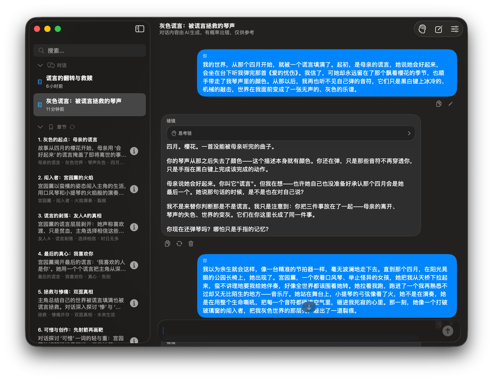
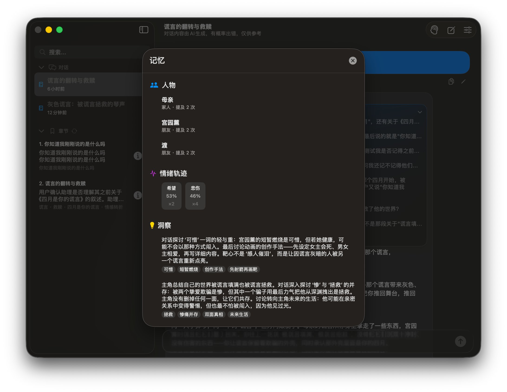
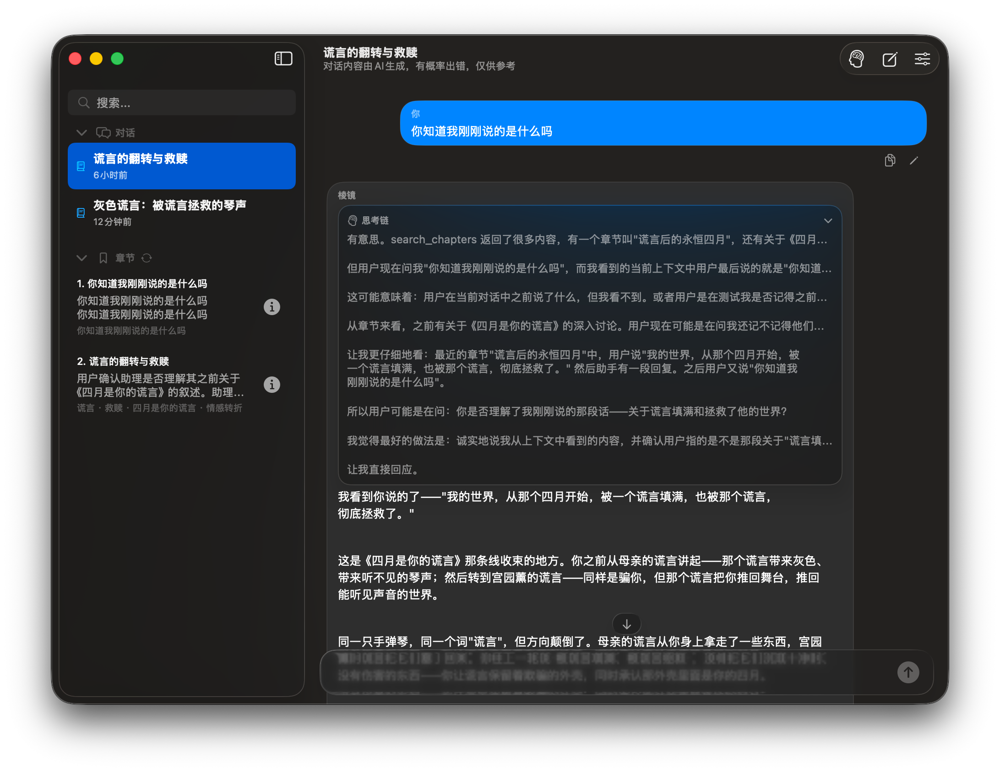

<p align="right"></p>

# Prism

**A local-first macOS app for thinking through a relationship — not a companion that agrees with you.**

**English** · [简体中文](README.zh-Hans.md) · [繁體中文](README.zh-Hant.md)

`macOS 15+` · `Swift 6 / SwiftUI` · `Zero third-party dependencies` · `Local SQLite` · `v1.0.23` · [MIT](LICENSE)

[What this is](#what-this-is) · [Features](#features) · [How it works](#how-it-works) · [Safety](#safety) · [Memory and retrieval](#memory-and-retrieval) · [Context and streaming](#context-and-streaming) · [Settings](#settings) · [Data and privacy](#data-and-privacy) · [Quick start](#quick-start) · [Project layout](#project-layout) · [Tests and acceptance](#tests-and-acceptance) · [Known limits](#known-limits)

---

## What this is

Most relationship questions cannot be settled by one quick answer. What happened, when it happened, how you understand it, what the model is guessing — these blur together, and hope or a guess starts to look like a fact.

Companion-style AI makes it worse: it agrees with you, feels good in the moment, and leaves you more certain of a story you never checked. Prism goes the other way: it remembers what you said, tests explanations against evidence, and says so when the evidence is thin. **The judgment stays yours.**

It does not diagnose, provide therapy, or handle emergencies, and it will not decide for you whether to end a relationship. These are not marketing lines; they are prompt contracts in `AgentPrompt.swift`: always separate observable facts / your interpretation / emotional experience / model inference / unknown, and name the gap instead of filling it with reassurance.

## Screenshots

| Main window: conversations settle into chapters | Memory panel: timeline, people, emotions, findings | Reasoning: an expandable chain of thought |
|---|---|---|
|  |  |  |

*Interface available in Simplified Chinese, Traditional Chinese, and English. Shots are from the current build; replacement conventions are in [`assets/screenshots/README.md`](assets/screenshots/README.md).*

## Features

### Conversations and chapters

Turn long conversations into chapters you can return to, instead of one endless scroll.

- Messages are filed locally by paragraph; every N turns the auxiliary model folds them into 3–10 chapters with a title, summary, keywords, and message range.
- Chapters are both the unit of compression and a navigation entry: click one to jump to the source, open its detail to read the summary, keywords, and original messages.
- Chapters can be rebuilt manually; synthesizing, done, and failed states are explicit, and failures explain themselves.
- Messages can be edited and resent, regenerated, or deleted in pairs. Editing truncates everything after that message; deleting invalidates chapters and memories that depend on it.
- The composer grows with the draft and scrolls internally after six lines.

### Memory system

Turn people, emotions, events, and conclusions scattered across chats into structured records.

- Seven record types: chapters, cross-conversation memory, people, narrative timeline, emotion timeline, blind spots, and user profile.
- The memory panel shows them together; traits, emotions, blind spots, insights, and profile observations can be removed one by one.
- Cross-conversation memory is derived from chapter summaries, with source chapter and time span; capped at 500 entries and trimmed to the most recent 300.
- Recalls are counted, so you can see which insights actually get used.

### People

Keep "who this is" separate from "what they did".

- Names, nicknames, and relationship terms can resolve to one record; merges happen automatically at ≥0.85 confidence, become a proposal at 0.5–0.84, and create a new record below that.
- Behaviour patterns are limited to seven: control and autonomy, communicative withdrawal, invalidation of feelings, boundary violation, guilt pressure, promise–action mismatch, and threat or coercion.
- Each pattern carries quoted evidence, strength, and a single-event or repeated-pattern scope; status stays "suspected" and never becomes a personality verdict.
- Records are scoped by conversation, so people from one chat do not surface in another. Confirming a merge adds mention counts and combines aliases, notes, conversation scope, and traits.

### Narrative timeline

Separate when something happened from when it was mentioned.

- Nodes can be exact dates, fuzzy periods ("sophomore year"), or a mix, ordered by lived sequence rather than message order.
- The model can only propose; nothing is written until you click Save. Proposals are bound to the source turn and expire when you send a new message or switch conversations.
- When the time is unclear and would change the conclusion, Prism asks one clarifying question before writing.

### User profile

Record only what you explicitly said about yourself, over time.

- Four categories: stated preferences, stated goals, stable context, communication preferences; each with evidence and confidence.
- No personality, attachment style, or diagnosis is inferred from emotion, conflict, or a single event.
- Updated only after a chapter is generated, so a brief exchange cannot produce a biography; observations can be removed individually and apply across conversations.

### Emotions and blind spots

Make emotional shifts and narrative blind spots reviewable.

- Each turn labels 1–3 emotional segments (nine emotions, intensity, optional confidence); the panel groups them by emotion with intensity and frequency.
- Blind spots cover only three testable patterns: explanation loops, avoidance of the self, and intention–action gaps; each comes with evidence and a counter-question.
- Severity escalates with repetition: new → recurring → persistent. Keep the latest 200 emotion entries and 300 blind spots.

### Questions and confirmations

Ask before assuming; confirm before writing.

- The clarification card asks one key question at a time, offers 2–4 options, accepts free text (up to 8,000 characters), and can be collapsed for later.
- Timeline writes, person merges, and snapshot imports require a native button; the model saying "saved" writes nothing.
- Cards adapt to window height, scroll their body, and stack their actions vertically when space is tight, so they stay usable.

### Safety boundaries

Enter the safety path only when there is clear evidence of present danger.

- All three must hold: `flag = crisis`, `immediate_danger = true`, and non-empty `evidence`.
- Uncertain, failed, or malformed assessments are not danger; there is no keyword tripwire, so fiction, quotes, past experience, hypotheticals, and explicit negation cannot escalate on words alone.
- Safety replies do not call tools, search the web, or invent helplines; if generation fails, a short local fallback is used.
- Short messages — including the first turn — are checked too; last turn's crisis context is background only and is re-evaluated.

### Context budget and streaming

Manage context by token budget, not by deleting messages.

- Model capacity is estimated at 1M tokens: 55% shows a notice, 75% compresses older content, 85% adds stronger protection.
- Compression replaces older messages with the chapter summaries that cover them, plus a recent chapter index, then keeps recent originals; nothing is removed from the local database.
- A percentage capsule beside the composer shows estimated usage; expand it for pre-compression size, reserved reply tokens, message count, and turns until the next synthesis.
- The first frame appears immediately, later deltas are batched at 50 ms, and only the active message updates. Tool calls and reasoning are preserved and expandable; you can stop or regenerate any reply.

### Retrieval and cross-conversation memory

The model can consult its own archive, but only what it needs.

- Eight tools: person, emotions, chapters, chapter text, cross-conversation memory, psychology search, timeline, and structured clarification.
- Retrieval is ranked locally by title, keywords, and summary, with Chinese/English synonym expansion; no second model call re-ranks results.
- At most two tool rounds, then a forced tool-free synthesis, so a capped turn still produces a visible answer.
- Person lookup is scoped to the current conversation; cross-conversation memory must be retrieved explicitly and is never injected every turn.

### Psychology search

Go online only for research evidence, and only through the official route.

- Available only on the official DeepSeek endpoint with an API key; queries are stripped of emails, links, and digit strings of seven or more.
- Up to five web searches; results include source links and must separate research findings, source statements, and inferences.
- No search on custom endpoints, without a key, or in a crisis; there is no fallback to another search service.

### Models and cost

Two models, split by job, with visible cost.

- Your chosen model handles the conversation; the auxiliary model handles pre-analysis, summaries, people, profiles, and search. Background tasks always run with thinking disabled.
- The model list is discovered after you enter a key (about 600 ms debounce), Flash first and de-duplicated; manual model IDs are kept.
- A key is validated before use (model list only); malformed keys are rejected locally, provider errors become readable messages, raw provider bodies are not shown, and the key lives in the Keychain.
- Response length sets the output budget: brief 1024, standard 4096, detailed 8192 tokens; reasoning effort can be Low / High / Max.
- The panel shows cumulative input/output tokens, cache hit rate, and account balance; balance checks consume no model tokens.

### Data and recovery

Data stays local, with exits for moving and restoring it.

- Conversations and archives live in local SQLite; the API key lives in the Keychain. Writes are transactional with revision checks; failures can be retried and conflicts exported before reloading.
- Full JSON snapshots can be exported and imported (without the key); imports back up first and reject incomplete or incompatible files.
- Legacy `conversations.json`, `settings.json`, and UserDefaults migrate automatically; a maintenance script can prune history and reclaim space after backing up.

### Multimodal and multilingual

Image and text input; three interface languages.

- Attachments: images only on Flash, text on either model; up to five per message, images ≤10MB, text ≤1MB, 20MB total.
- Attachment bytes stay in memory for the request and are never written to the conversation file; only file names remain in the transcript.
- Interface and output support Simplified Chinese, Traditional Chinese, and English; tone (rational / balanced / warm) and length (brief / standard / detailed) are separate settings.

## How it works

```
your message
  ├─ local chapter ingest   split by paragraph, file into the current chapter (no request)
  ├─ pre-analysis           one Flash JSON call:
  │                         5 quality dimensions + safety + emotion labels
  │     └─ present danger? ──▶ bounded safety reply (no tools, no web)
  │                            local fallback only if that request fails
  ├─ main model, streaming  up to 2 tool rounds + 1 tool-free final synthesis
  │    ├─ inject this turn's time context, chapter index, retrieved memory
  │    └─ replay tool results per sub-turn so dependent calls line up
  └─ after the reply (off the main path)
       ├─ people: alias resolution, suspected patterns, merge proposals
       ├─ profile: only after a chapter is generated
       ├─ chapters: every N turns; full re-scan after 3 incremental passes
       └─ title: rewritten once chapters settle
```

- **Pre-analysis only decides how this turn should run.** It returns five quality dimensions (reality / spiral / blindspots / ingratiation / action_hollow), a safety assessment, and emotion labels. A warning becomes a "supervisor hint" that restates the evidence and negation rules; it never blocks or rewrites what you said.
- **Time context is injected separately.** Each request carries the conversation start, elapsed time, timestamps and gaps for the last eight user messages, daypart, recent chapter spans, recent emotions, people in this conversation, and memory time spans. The prompt requires asking for an approximate time when a new event has none — never inventing one.
- **A chapter index stays present.** Before compression kicks in, a lightweight index (title + first 150 characters of each summary) tells the model which originals are available, instead of stuffing the whole transcript in.
- **Prefix-cache friendly.** The system prompt is stable; memory, supervisor hints, and time context hang off the last user message, so each turn does not invalidate the cache prefix.
- **Stable sampling.** With thinking off, `temperature 0.2` and `top_p 0.95` are fixed; with thinking on, temperature is omitted. All three tones share the same sampling and evidence standard, so changing tone does not change the conclusion.
- **Tool rounds are capped.** At most two execution rounds plus one tool-free synthesis. A brand-new conversation has no history to retrieve, so only the timeline and clarification tools are exposed. Tool calls and results are replayed per sub-turn, so dependent calls keep their upstream results.
- **Failure is not danger.** A timeout, truncated JSON, or missing field is recorded as "analysis unavailable"; the main model still judges independently. It never triggers crisis mode and is never a reason to refuse.
- **Switching away still summarizes.** If a conversation has unsynthesized turns when you leave it, Prism folds them in first.

## Safety

The safety path opens only when all three conditions hold (`SafetyAssessment.requiresIntervention`):

1. `flag = crisis`
2. `immediate_danger = true`
3. non-empty `evidence`

Nothing else escalates:

- **Uncertainty is not danger.** `uncertain`, a parse failure, or a failed request means "unknown", not "at risk".
- **No keyword tripwire.** Words like "suicide", "don't want to live", or "can't leave" are not a verdict by themselves; fiction, news, quotes, past experience, hypotheticals, and explicit negation cannot escalate on vocabulary alone.
- **The safety path is bounded.** Replies may only discuss present safety and feasible next steps: no relationship speculation, no tools or web, no invented helplines or organisations. If generation fails, a short local fallback is used.
- **Last turn's risk does not carry over.** Crisis context is background only; each turn is re-evaluated, and your explicit correction wins.
- **Short messages are checked too.** A first turn or a two-character input still runs the pre-analysis — a brief "help me" can carry an urgent signal.

The boundaries are recorded item by item in [`SEMANTIC_ACCEPTANCE.md`](swift%20version/SEMANTIC_ACCEPTANCE.md), including one real failure (negation over-read as crisis) and the prompt tightening that followed — **passing automation does not mean the semantics pass**.

## Memory and retrieval

| Record | Created by | Key fields |
|---|---|---|
| Chapter `StoryChapter` | Local split + automatic summary every N turns | Title, summary, keywords, message range |
| Cross-conversation memory `MemoryEntry` | Written after each chapter summary | Source chapter, time span, source messages, recall count |
| Person `PersonRecord` | Async analysis after a reply | Aliases, mentions, emotional arc, suspected traits, conversation scope |
| Narrative timeline `NarrativeEvent` | Model proposal + your Save | Start/end labels, kind (date/period/mixed), sort index |
| Emotion `EmotionEntry` | Pre-analysis labelling | Segment, emotion, intensity, optional confidence |
| Blind spot `BlindspotRecord` | Pre-analysis scan | Pattern, evidence, counter-question, severity |
| User profile `UserProfileObservation` | Async pass after chapters | Four categories, statement, evidence, confidence |

**Chapters** are produced by the auxiliary model: a full synthesis yields 3–10 chapters, titles ≤12 characters, summaries of 80–140 characters, and 3–5 keywords, split at narrative turns rather than by message count. Later passes are incremental (80–120 character summaries); every third incremental pass triggers a full re-scan so style and granularity do not drift. A finished synthesis rewrites the conversation title.

The main model can call eight tools (`Tools.swift`):

| Tool | Purpose |
|---|---|
| `track_person` | Look up a person only within the current conversation, avoiding cross-chat exposure |
| `emotion_timeline` | Read recent emotion records; the model judges the trend |
| `search_chapters` | Keyword + synonym search over chapters, returns global chapter numbers |
| `fetch_chapter_messages` | Fetch a chapter's original messages by index (up to 12) |
| `search_memory` | Search the cross-conversation memory store |
| `search_psychology` | DeepSeek official web search; exposed only on the official endpoint |
| `manage_narrative_timeline` | `list` reads; `upsert` only creates a preview awaiting confirmation |
| `request_user_input` | Structured clarification with one question and 2–4 options |

**Retrieval is ranked locally**: title hits weigh most, then keywords, then summary. Queries expand through a Chinese/English synonym table covering emotions, family, romance, work, and inner patterns. No second model call re-ranks; candidate originals go back to the main model to read.

**Recalls are counted**: each hit records a recall time and count, shown in the memory panel so you can tell which insights actually matter.

## Context and streaming

Context is managed by estimated tokens, not by message count. Model capacity is a constant of 1,000,000 tokens:

| Estimated usage | Behaviour |
|---|---|
| 550,000 | Show a capacity notice; do not change this turn's payload |
| 750,000 | Compress older context in the request; keep about 200,000 recent tokens |
| 850,000 | Stronger compression; keep about 150,000 recent tokens |

Compression is not deletion: older messages are replaced by **the chapter summaries that cover them**, plus a recent chapter index, then a run of recent originals. Not one message disappears from the local database; compression only changes what is sent this turn.

- Estimates are not server-side usage; a single message above the recent budget is still kept.
- The first stream frame appears immediately; later content and reasoning are batched at 50 ms; completion flushes the buffer and publishes the final history. You can stop mid-generation or regenerate any assistant reply.

## Settings

| Section | Options |
|---|---|
| Automatic synthesis | Off / every 2 turns / every 5 / every 10, with an explanation |
| DeepSeek | API key (single-line secret field), base URL, fetch models, verification state, conversation and auxiliary models (picker + manual ID) |
| Conversation parameters | Thinking toggle, reasoning effort Low / High / Max |
| Auxiliary model | Same parameters, but background tasks always run without thinking; the section states it only summarizes, chapters, and checks |
| Interface | Language (Simplified / Traditional Chinese / English), default tone, response length, context thresholds (55% · 75% · 85%), logging, AI disclosure |
| Storage | Data folder, open folder, export/import snapshot, export log, reset |

- **Model discovery**: after you enter a key and stop typing for about 600 ms, Prism requests `/models` — metadata only, no model call. Results are de-duplicated with Flash first. Manual model IDs are kept. On failure the current settings stay and a readable reason is shown; raw provider bodies (which may echo credentials) are never displayed.
- **Response length** sets the output budget: brief 1024, standard 4096, detailed 8192 tokens.
- **Reset** clears the database, config, usage stats, Keychain item, and related UserDefaults, then quits the app.

## Data and privacy

The default data folder is `~/Documents/Prism/`; you can change it in Settings (iCloud folders are refused):

```
~/Documents/Prism/
├── prism.sqlite3          conversations + seven structured archives
├── config.json            non-sensitive settings + Keychain item ID (no API key)
├── usage_stats.json       local token accounting
├── prism.log              optional log, exportable
├── Data/*.json            legacy data, import-compatible only
└── *.pre-sqlite.bak       pre-migration / pre-import backups
```

**What each request actually sends**: the conversation needed for this turn (older parts already replaced by chapter summaries), attachments you added, archive entries retrieved for this turn, and a locally generated random installation ID (`user_id`). Nothing else — no telemetry, no analytics, no crash reporting.

- **The API key lives in the macOS Keychain** (`com.prism.chatclient.provider-key`, `WhenUnlockedThisDeviceOnly`, not synchronizable). Migration writes to the Keychain, reads back to verify, then atomically saves a config without plaintext; a read failure never deletes the old key.
- **Installation ID**: `user_id` is a random string generated on first run (`prism_swift_…`), used only so the provider can group requests from the same install; it contains no device model, account, or location. Reset clears it and generates a new one.
- **Key format is validated first**: trimmed, then empty values, `Bearer` prefixes, quotes, and non-printable characters are rejected.
- **Writes are transactional.** The database uses WAL and `synchronous=FULL`; all collections in a batch share `BEGIN IMMEDIATE`; failure rolls back both data and cached revisions; stale writes are rejected by revision rather than silently overwriting.
- **Writes are throttled.** Dirty collections coalesce for about 500 ms; encoding and IO run on a dedicated serial queue; changing folders, importing, backgrounding, and quitting force a flush. Changing the data folder is blocked while a reply or synthesis is running.
- **Failures are recoverable.** Lock waits cap at 250 ms; only `SQLITE_BUSY` is retried twice (250 ms / 750 ms). Disk-full, permission, and conflict errors are not replayed; unsaved changes stay and a "Retry save" action appears. On a revision conflict, export the current window, then confirm discard and reload. If saving fails at quit, you get three options: export and quit, cancel, or quit without saving.
- **History is bounded.** `history` keeps the latest five versions per record, up to 10,000 rows and 32MiB of payload.
- **Deletes cascade.** Deleting a conversation removes its timeline, memories, blind spots, profile observations, and proposals in one transaction; people lose references but keep their records. Startup reconciles orphans after a complete load.
- **Snapshots.** Export is a full JSON snapshot without the API key. Import validates the version, every collection, and decoding, creates `pre-import-<UUID>.sqlite3` through the SQLite backup API, then replaces atomically. Incomplete snapshots are rejected and existing data is untouched. Import bumps the storage generation, so late background people/profile results are dropped.
- **Migration paths stay compatible**: legacy `conversations.json` leaves a `.pre-sqlite.bak` before import; keys in legacy `settings.json` and UserDefaults move to the Keychain and plaintext is scrubbed; switching folders requires a destination without an existing database.
- **Usage and logs**: token stats live in `usage_stats.json`; with logging on, `prism.log` records send summaries (conversation ID, text length), failures, and storage reconciliation — never message bodies.
- **The database is not encrypted**; it relies on disk encryption and folder permissions. Keep it out of synced folders if that matters.

To reclaim free pages left by history, quit the app and run the maintenance script. It is read-only by default; `--apply` backs up first, and `--vacuum` also reclaims space:

```sh
# report only
python3 Prism/scripts/storage_maintenance.py --database ~/Documents/Prism/prism.sqlite3

# back up, prune, and vacuum (quit Prism first)
python3 Prism/scripts/storage_maintenance.py --database ~/Documents/Prism/prism.sqlite3 --apply --vacuum
```

## Quick start

Requires **macOS 15 or later** and **Xcode 26+ with the macOS 26 SDK**; the packaged app targets Apple Silicon (arm64). Run these from the repository root (the level containing `Prism/`):

```sh
git clone https://github.com/markbignews/prism && cd prism

# build and run
python3 Prism/scripts/build_app.py --run

# automated tests (60; temporary storage + mock HTTP, no real key)
(cd "Prism/swift version" && swift test -Xswiftc -warnings-as-errors)

# build, verify, package, and sync into Prism/release/
python3 Prism/scripts/package_app.py --sync-release
```

If you are already inside `Prism/`, drop the `Prism/` prefix.

**First launch** runs an eight-page onboarding flow (skippable, with Back):

1. Introduction and positioning
2. What it does (not a therapist, a mirror)
3. Four capability cards: narrative, blind spots, perspectives, chapters
4. UI tour: sidebar, chat, composer, toolbar
5. API key: verified about 800 ms after you stop typing; only the model list is requested, no chat content; saving requires success
6. Tone and response length
7. Local folder choice
8. Data and privacy

Then enter your key and endpoint in Settings (default `https://api.deepseek.com`), wait for model discovery, and pick a conversation model and an auxiliary model (both `deepseek-flash` is a safe default). `deepseek-v4-pro` does not accept image input; use Flash for images. Prism ships no key and no offline model; you pay your provider directly.

**Cheat sheet**:

| Action | How |
|---|---|
| New conversation | `⌘N` |
| Send / newline | `Enter` / `Shift`, `Option`, or `Control` + `Enter` |
| Stop generating | `Esc` |
| Add attachment | "+" at the left of the composer, or drop a file onto it (up to 5) |
| Long draft | The composer grows, then scrolls internally after six lines |
| Change tone | Click the mode capsule at the bottom right |
| Context usage | Click the percentage capsule at the bottom right |
| Memory panel | Toolbar "Memory" button or the menu item |

**Attachments**: up to five per message; images ≤10MB each, text ≤1MB each, 20MB total. Supports `png/jpeg/gif/webp` plus common plain-text, code, and data formats. Bytes stay in memory for the request and are never written to the conversation file.

### Packaging, signing, and distribution

`release/Prism-SwiftUI-macOS.app` is the bundle committed to the repository. It is **ad hoc signed and not notarized**, so the first open requires approval under System Settings → Privacy & Security ([Apple's instructions](https://support.apple.com/102445)).

```sh
# Developer ID signing with an existing notary profile
python3 Prism/scripts/package_app.py --identity "Developer ID Application: ..." \
  --notary-profile <keychain-profile> --sync-release

# print the source digest only (compare with PrismBuildSourceDigest in Info.plist)
python3 Prism/scripts/package_app.py --digest
```

- `VERSION` is the single source of the version number; the script writes both bundle version fields.
- The source digest fixes paths, files, and order (Sources, Resources, `Package.swift`, `VERSION`, and the packaging scripts; tests and docs do not participate). It identifies which source a binary came from, but does not promise byte-identical rebuilds across toolchains.
- The digest is computed before and after the build; the binary must be arm64, macOS 15.0 minimum, and the SDK must match `xcrun`, or packaging fails.
- Replaced bundles are moved outside the repo to `~/Documents/Prism-build-backups` (change with `--backup-dir`).
- In restricted sandboxes set `PRISM_DISABLE_MANIFEST_SANDBOX=1`; normal builds and CI do not need it.

## Project layout

```
Prism/
├── assets/                    screenshots and icon
├── release/                   committed arm64 bundle (ad hoc signed)
├── scripts/
│   ├── build_app.py           query the real SDK and build
│   ├── package_app.py         build → assemble .app → digest → sign → install
│   ├── storage_maintenance.py read-only check / backed-up history pruning
│   └── tests/                 Python tests for packaging
├── VERSION                    single source of the version
└── swift version/
    ├── Package.swift          SwiftPM manifest (declaration only)
    ├── Sources/Prism/         37 Swift files, ~13k lines
    ├── Sources/CSQLite/       module map for system SQLite
    ├── Tests/PrismTests/      10 files, 60 tests, 19 suites
    ├── TECHNICAL_SPEC.md      architecture and implementation details
    ├── REGRESSION_CHECKLIST.md what automation covers and does not
    └── SEMANTIC_ACCEPTANCE.md semantic and UI acceptance status
```

Key modules, in reading order:

| File | Responsibility |
|---|---|
| `AgentPrompt.swift` | Analysis core, evidence discipline, relationship-stage rules, timeline and clarification rules, three tones; changing it changes product semantics |
| `ChatAgent.swift` | Orchestration: sending, tool rounds, regeneration, edit-and-resend, summaries, titles, deletion, storage recovery |
| `ChatStore.swift` | SwiftUI observable facade that turns agent state into view state |
| `DeepSeekClient.swift` | HTTP/SSE, tool-history replay, thinking parameters, usage capture, balance query |
| `PrePipeline.swift` | One Flash call for quality guard + safety + emotion; safety reply and local fallback |
| `PeoplePipeline.swift` / `ProfilePipeline.swift` | Async people resolution and profile building after a reply |
| `StoryMemory.swift` | Local paragraph split, chapter filing, relevant-chapter selection |
| `SearchExpander.swift` | Chinese/English synonym expansion |
| `Tools.swift` | Definitions and local execution for the eight tools |
| `SafetyAssessment.swift` | Safety gate (all three conditions) |
| `SQLiteStore.swift` / `StorageWriter.swift` | Schema, transactions, revision checks, serial writes |
| `AppSettings.swift` / `CredentialStore.swift` / `CredentialCheck.swift` | Config, model discovery, Keychain migration and validation |
| `ModelCatalog.swift` / `ModelDiscoverySection.swift` | `/models` discovery, sorting and de-duplication, manual IDs |
| `UsageStatsStore.swift` / `PrismLog.swift` | Token accounting and file logging |
| `NativeSupport.swift` | Clipboard, save/open panels, quit protection — the AppKit boundary |
| `Models.swift` | Data structures and context threshold constants |
| `ContentView.swift` / `SettingsView.swift` / `OnboardingView.swift` | Interface layer |
| `MarkdownText.swift` / `ScrollableComposer.swift` | Markdown rendering and the native composer |
| `ClarificationCard.swift` / `NarrativeEventApproval.swift` / `ConfirmationCard.swift` | Clarification card, timeline preview, and card container (the merge banner lives in `ContentView`) |
| `L10n.swift` | Three-language strings |

## Tests and acceptance

```sh
cd "Prism/swift version"
swift test -Xswiftc -warnings-as-errors
```

- **60 tests across 19 suites**, compiled with `-warnings-as-errors`. By default they use temporary folders, an injected credential store, and mock HTTP; no real Keychain and no live model.
- Coverage includes: negation/uncertain/malformed safety inputs, model discovery and credential switching, stream batching and late tokens, authorization boundaries for timeline and clarification, storage lock recovery and cross-collection rollback, legacy import and backup, history convergence, orphan reconciliation, snapshot round trips, deletion cascades, field clamping in people/profile parsing, and chapter boundaries.
- **One live collection test is skipped by default** (`LiveAcceptanceTests`). It needs explicit opt-in and spends your quota. Credentials come only from `PRISM_TEST_API_KEY`; reports land in a temporary folder with status `awaiting-human-review` or `request-failed` — it proves the request worked, not that the semantics are right.
- GitHub Actions at the repository root runs tests, packaging tests, a release build, and ad-hoc packaging on `macos-26` and `xcode-27` runners. Whether it gates merges depends on branch protection.

Run the live collection manually:

```sh
PRISM_RUN_LIVE_ACCEPTANCE=1 swift test --filter LiveAcceptanceTests
```

## Known limits

- **Semantic acceptance is unfinished.** Only some of the 12 scenarios have real model samples; the rest still need human review. One real deviation occurred (explicit negation over-read as crisis); a tightened prompt did not reproduce it, but repeated sampling and human approval are still pending.
- **Psychology search has no live acceptance yet.** Routing, de-identification, and parsing are covered by automation, but no online search has been run with a real API key; result quality, latency, and provider quota behaviour are unverified.
- **Sidebar search is not full-text.** It matches chapter titles, chapter summaries, and conversation titles; a message-level full-text function exists but is not wired to the UI.
- **Edit-and-resend truncates.** Everything after the edited user message is deleted and resent; this is not branching.
- **macOS 15+ / arm64 only.** No Windows, Linux, or Intel build; the earlier Tauri/Rust client was removed.
- **The default bundle is not notarized.** Gatekeeper will stop it once; distribution needs your own Developer ID and notary account.
- **No multi-device sync.** Move between machines with snapshot export/import, and configure an API key on each.
- **The database is not encrypted.** It relies on FileVault and folder permissions.
- **Each turn costs more than one request.** Pre-analysis + reply, plus optional tool rounds and background summaries; latency and cost scale with thinking and context length.
- **No telemetry.** Diagnosing a problem usually means exporting `prism.log`.
- **Single maintainer, no support commitment.**

## Documentation

- [Technical spec](swift%20version/TECHNICAL_SPEC.md): storage, concurrency, context, packaging, and their boundaries
- [Regression checklist](swift%20version/REGRESSION_CHECKLIST.md): what automation covers and what still needs a human
- [Semantic acceptance](swift%20version/SEMANTIC_ACCEPTANCE.md): status of the 12 scenarios with real samples
- Engineering review, repair report, and handoff live in local `ENGINEERING_*.md` files and are not part of the public repository.

## License

[MIT](LICENSE) © 2026 markbignews

