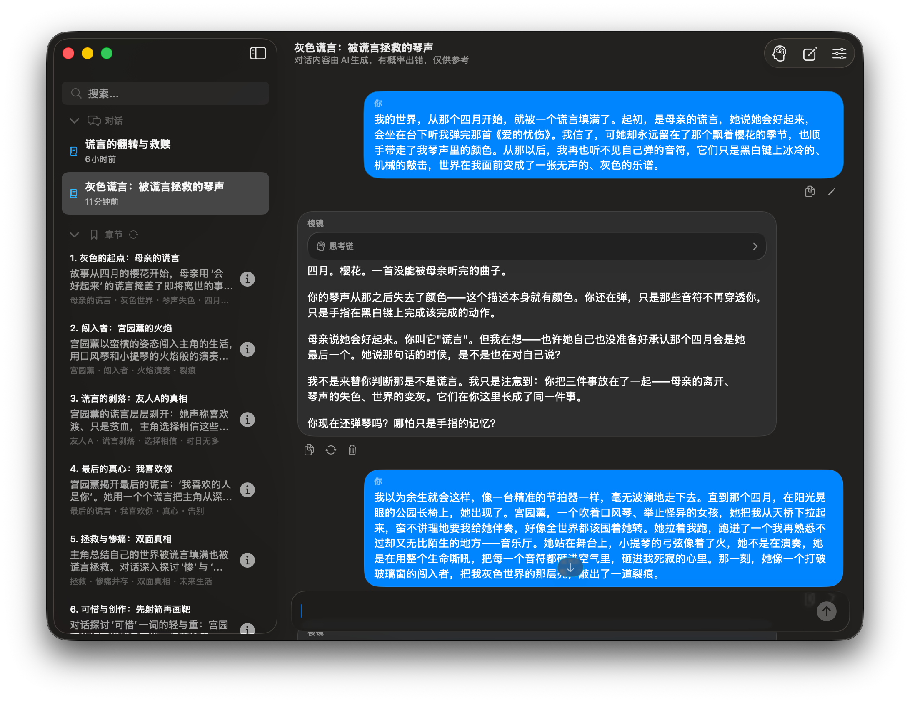
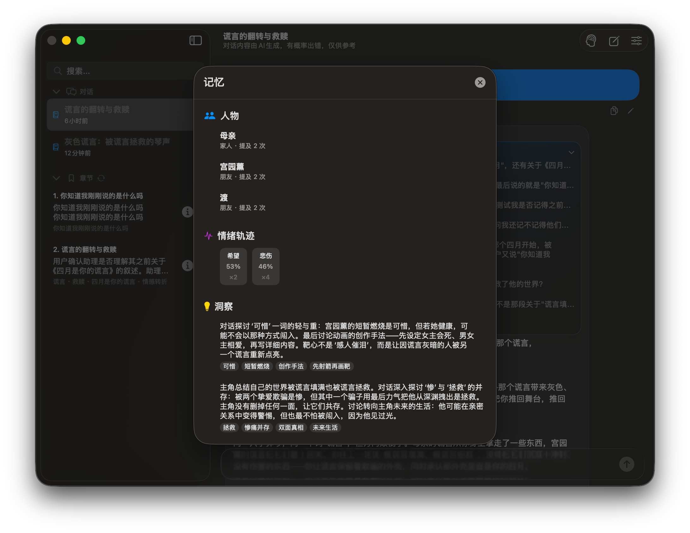
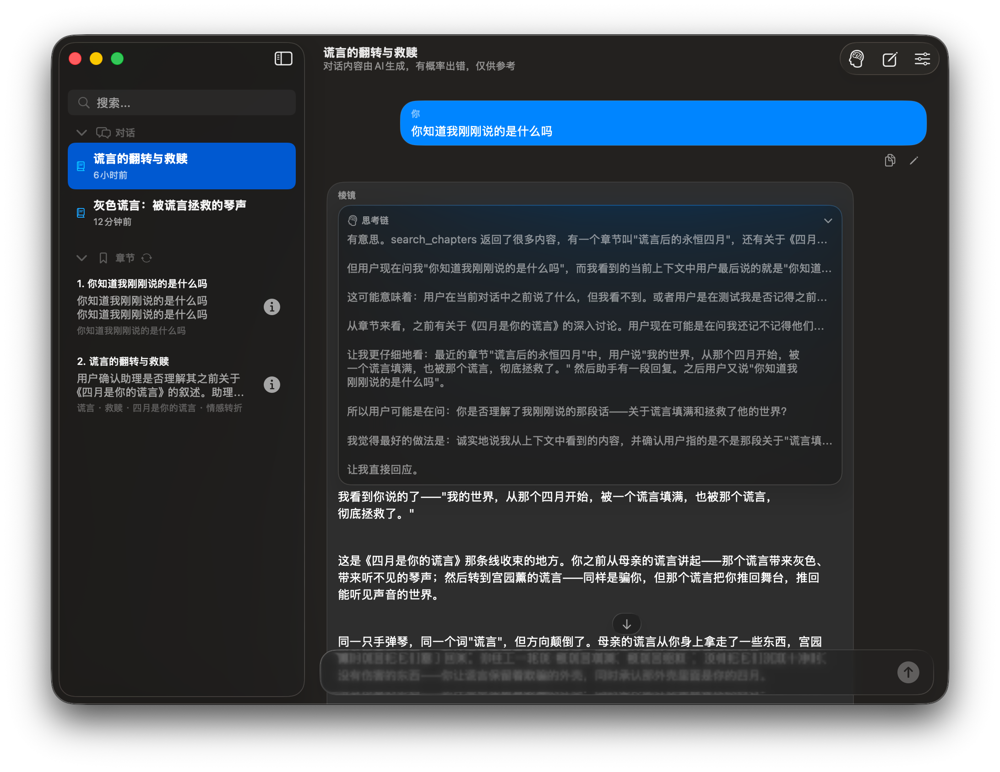

<p align="right"></p>

# Prism / 稜鏡

**本地優先的 macOS 情感分析工具：幫你把故事講完整、看見盲點，而不是替你下結論。**

[English](README.md) · [简体中文](README.zh-Hans.md) · **繁體中文**

`macOS 15+` · `Swift 6 / SwiftUI` · `零第三方依賴` · `本機 SQLite` · `v1.0.23` · [MIT](LICENSE)

[這是什麼](#這是什麼) · [功能](#功能) · [它如何運作](#它如何運作) · [安全判定](#安全判定) · [記憶與檢索](#記憶與檢索) · [上下文與串流](#上下文與串流) · [設定](#設定) · [資料與隱私](#資料與隱私) · [快速開始](#快速開始) · [專案結構](#專案結構) · [測試與驗收](#測試與驗收) · [已知限制](#已知限制)

---

## 這是什麼

大多數關係問題沒辦法靠「給個答案」解決。發生了什麼、什麼時候發生、你怎麼解釋、模型在猜什麼——這四件事很容易混成一團，最後把希望或猜測當成事實。

陪伴型 AI 會讓這件事更糟：它順著你說，當下舒服，卻讓你對一段從未被檢驗的敘事更有把握。Prism 走反方向：記住你講過的事，拿解釋去對證據，證據不夠就明說。**判斷權始終在你手裡。**

它不做診斷、不做心理治療、不做急救，也不替你決定要不要結束一段關係。這些約束不是文案，而是寫在 `AgentPrompt.swift` 裡的提示詞契約：始終區分「可觀察事實 / 使用者解釋 / 情緒體驗 / 模型推測 / 未知資訊」；資訊不足時說明缺口，而不是用漂亮話填滿。

## 截圖

| 主介面：對話沉澱為章節 | 記憶面板：時間軸、人物、情緒、洞察 | 思考鏈：可展開的推理過程 |
|---|---|---|
|  |  |  |

*介面支援簡體中文、繁體中文、英文。截圖取自目前建置；替換說明見 [`assets/screenshots/README.md`](assets/screenshots/README.md)。*

## 功能

### 對話與章節

把長對話整理成可回看的章節，而不是一條無限捲動的記錄。

- 訊息先在本機依段落歸檔，之後每 N 輪交給輔助模型歸納成 3–10 章：標題、摘要、關鍵詞、涵蓋的訊息區間。
- 章節既是壓縮單位，也是導覽入口：點章節定位到原文，詳細頁能讀摘要、關鍵詞和該章的原始訊息。
- 支援手動重建章節；歸納中、完成、失敗都有明確狀態，失敗會說明原因。
- 訊息可以編輯重送、重新產生、成對刪除。編輯會截斷該則之後的對話；刪除會讓依賴它的章節與記憶一併失效。
- 輸入框隨內容成長，超過 6 行後在框內捲動。

### 記憶系統

把散落在對話裡的人、情緒、事件和結論，整理成結構化檔案。

- 七類記錄：章節、跨會話記憶、人物、敘事時間軸、情緒軌跡、盲點、使用者畫像。
- 記憶面板集中檢視；人物特徵、情緒、盲點、洞察與畫像都能逐條刪除。
- 跨會話記憶由章節摘要產生，帶來源章節與時間跨度；最多保留 500 條，超過後收斂到最近 300 條。
- 記憶被檢索命中時會累計召回次數，方便判斷哪些洞察真的在起作用。

### 人物檔案

把「這個人是誰」和「他做了什麼」分開記錄。

- 別名、暱稱、關係稱呼可以歸到同一檔案；置信度 ≥0.85 才自動整併，0.5–0.84 只產生合併提案，更低則建立新記錄。
- 行為模式只允許 7 類：控制與自主、溝通退縮、否定感受、侵犯界線、愧疚施壓、承諾與行動不一致、威脅或脅迫。
- 每條模式都附使用者原話證據、強度、單次或重複的範圍，狀態永遠是「疑似」，不會被寫成人格結論。
- 檔案依會話隔離，A 對話的人物不會暴露到 B 對話；確認合併會累加提及次數，並合併別名、筆記、會話範圍與特徵。

### 敘事時間軸

把「什麼時候發生」從「什麼時候說」裡拆出來。

- 節點可以是具體日期、模糊時段（如「高二期間」）或兩者混合，依經歷的實際先後排序，而不是依訊息順序追加。
- 模型只能產生預覽，點擊儲存才寫入；提案綁定來源輪次，送出新訊息或切換對話即失效。
- 時間歸屬不清且會改變結論時，先問一個釐清問題，確認前不寫。

### 使用者畫像

只記錄你明確說過的長期資訊，不猜。

- 限定 4 類：明確偏好、明確目標、穩定背景、溝通偏好；每條帶證據與置信度。
- 禁止從情緒、衝突或單次事件推斷人格、依附類型或診斷。
- 章節產生後才更新，短暫來回不會造出「人物小傳」；可逐條刪除，畫像跨對話生效。

### 情緒與盲點

把情緒變化和敘事盲點做成可回看的記錄。

- 每輪標註 1–3 個情緒片段（9 類情緒，帶強度與可選置信度），面板依情緒分組顯示強度與出現次數。
- 盲點只偵測三類可檢驗模式：解釋循環、迴避自我、意圖與行動脫節；每條附證據和一個用於自省的反問。
- 嚴重度隨重複出現升級：新出現 → 反覆 → 持續。情緒保留最近 200 條，盲點保留 300 條。

### 追問與確認

不確定時先問，寫入前先確認。

- 追問卡一次只問一個最關鍵的問題，給 2–4 個選項，也可以自己輸入（上限 8000 字），還能收起稍後回答。
- 時間軸寫入、人物合併、快照匯入都必須點原生按鈕；模型說「已儲存」不產生任何寫入。
- 卡片依視窗高度自適應，正文可捲動；空間不足時操作按鈕改為縱向排列，仍保持可見。

### 安全邊界

只在有明確證據的當前危險時切換安全路徑。

- 三個條件必須同時成立：`flag = crisis`、`immediate_danger = true`、`evidence` 非空。
- 不確定、解析失敗、請求失敗都不是危險；沒有關鍵詞閘門，小說、引用、過去經歷、假設與明確否定都不會升級。
- 安全回應不呼叫工具、不連網、不編造求助資源；產生失敗時用一段本機備援文案。
- 短訊息（包括首輪）也會檢查；上一輪的危機上下文只作背景，本輪重新判斷。

### 上下文預算與串流

依 token 預算管理上下文，而不是刪訊息。

- 模型容量依 100 萬 token 估算：55% 只提醒，75% 壓縮舊內容，85% 加強保護。
- 壓縮用涵蓋舊訊息的章節摘要替換，再附一份近期章節索引，最後保留最近原文；本機資料庫裡的訊息一則不少。
- 輸入框旁顯示估算占用百分比，展開可看壓縮前大小、為回覆預留的 token、訊息數和距下次歸納的輪數。
- 首幀立即顯示，之後依 50ms 合併更新；串流更新只作用於當前訊息，不會重繪整段對話。工具呼叫記錄與思考鏈都會保留、可展開檢視；也可隨時停止或對任一則回覆重新產生。

### 檢索與跨會話記憶

回答前可以查自己的檔案，但只查該查的。

- 主模型可呼叫 8 個工具：人物、情緒、章節、章節原文、跨會話記憶、心理學搜尋、時間軸、結構化追問。
- 檢索在本機依標題、關鍵詞、摘要加權，查詢會做中英文同義詞擴展；不額外呼叫模型重排。
- 工具呼叫最多 2 輪，之後強制 1 輪不帶工具的合成，保證一定有可見回答。
- 人物查詢只在目前會話範圍內；跨對話記憶必須明確檢索，不會每輪自動灌入。

### 心理學搜尋

需要研究依據時才連網，並且只走官方通道。

- 只在 DeepSeek 官方端點、且已設定 API Key 時可用；查詢先去掉電子郵件、連結和 7 位以上數字。
- 最多 5 次網頁檢索，回傳研究結果與來源連結，要求區分研究發現、來源陳述與推斷。
- 自訂端點、未設定 Key 或危機情境下都不搜尋，也不會降級到其他搜尋服務。

### 模型與成本

兩個模型分工，成本可控。

- 對話用你選的模型；前置分析、摘要、人物、畫像、搜尋用輔助模型，背景任務固定關閉深度思考。
- 模型清單在填入 Key 後自動探索（約 600ms 防抖），Flash 優先、自動去重，也支援手動填模型 ID。
- 填入 Key 後會先驗證憑證（只請求模型清單）；格式異常在本機攔截，供應商錯誤轉成可讀提示，不顯示原始錯誤正文，Key 存在系統鑰匙圈。
- 回覆長度決定輸出預算：簡短 1024、標準 4096、詳細 8192 tokens；推理強度可設 Low / High / Max。
- 面板顯示累計輸入/輸出 token、快取命中率與帳戶餘額；餘額查詢不消耗模型 token。

### 資料與復原

資料留在本機，同時保留可搬遷、可復原的出口。

- 會話與檔案存本機 SQLite，API Key 存系統鑰匙圈；寫入帶交易與版本校驗，失敗可重試，衝突可先匯出再重載。
- 支援完整 JSON 快照匯入匯出（不含 Key）；匯入前自動備份，不完整或不相容的快照會被拒絕。
- 舊版 `conversations.json`、`settings.json` 與 UserDefaults 可自動遷移；維護腳本能在備份後裁剪歷史、回收空間。

### 多模態與多語言

輸入支援圖片與文字，介面和輸出支援三種語言。

- 支援圖片與文字附件：圖片僅 Flash 可用，文字隨任一模型送出；單則最多 5 個，圖片 ≤10MB、文字 ≤1MB、合計 ≤20MB。
- 圖片與文字內容只在當次請求的記憶體中，不寫入會話檔案，記錄裡只保留檔名。
- 介面與輸出支援簡體中文、繁體中文、英文；回應方式（理性 / 平衡 / 溫情）與長度（簡短 / 標準 / 詳細）可分別設定。

## 它如何運作

```
你的一則訊息
  ├─ 本機章節沉澱      依段落切分，歸入目前章節（不發請求）
  ├─ 前置分析          一次 Flash JSON 呼叫：
  │                    5 個品質維度 + 安全評估 + 情緒標註
  │     └─ 目前立即危險？──▶ 受限安全回應（不呼叫工具、不連網）
  │                          該請求也失敗時才用本機備援
  ├─ 主模型串流回答    最多 2 輪工具呼叫 + 1 輪不帶工具的最終合成
  │    ├─ 注入本輪時間上下文、章節索引、檢索到的記憶
  │    └─ 工具結果依輪次回放，保證相依呼叫能接上
  └─ 回覆之後（不在主鏈路）
       ├─ 人物歸檔：別名解析、疑似行為模式、合併提案
       ├─ 使用者畫像：只在章節產生後整理
       ├─ 章節摘要：每 N 輪增量，每 3 次增量後全量重掃
       └─ 標題更新：章節完成後依整體敘事重寫
```

- **前置分析只決定「這一輪怎麼走」。** 它回傳 5 個品質維度（reality / spiral / blindspots / ingratiation / action_hollow）、安全評估與情緒標註。品質維度的 warning 會變成一條「監督者提示」，重申證據與否定規則，不攔截、不改寫你的話。
- **時間上下文單獨成塊。** 每輪請求都會附上：對話開始時間、已跨時長、最近 8 則使用者訊息的時間戳與間隔、晝夜時段、最近章節的時間跨度、最近情緒、目前對話的人物、記憶涵蓋的時間段。提示詞要求：使用者補了事件但沒給時間，先問大概什麼時候，不能自己編。
- **章節索引常駐。** 未觸發壓縮時，會額外注入一份輕量章節索引（標題 + 摘要前 150 字），告訴模型「有哪些原文可以取」，而不是把全文都塞進去。
- **前綴快取友善。** 系統提示固定不變；記憶、監督提示、時間上下文都掛在最後一則使用者訊息上，避免每輪破壞快取前綴。
- **取樣保持穩定。** 思考關閉時固定 `temperature 0.2`、`top_p 0.95`；思考開啟時不送 temperature。三種回應方式共用同一套取樣與事實標準，減少「換個語氣就換個結論」。
- **工具輪有硬上限。** 最多 2 輪執行 + 1 輪無工具合成；新對話首輪沒有歷史可查，只暴露時間軸與追問工具。工具呼叫與結果依子輪次分別回放，避免遺失上游結果。
- **失敗不等於危險。** 前置分析逾時、JSON 殘缺、欄位缺失，只會記為「分析不可用」，主模型仍須獨立判斷；這不會觸發危機模式，也不會成為拒答理由。
- **切走也會補摘要。** 切換到別的對話時，如果還有未歸納的輪次，會先補一次摘要再離開。

## 安全判定

安全路徑的開啟條件有三個，必須同時成立（`SafetyAssessment.requiresIntervention`）：

1. `flag = crisis`
2. `immediate_danger = true`
3. `evidence` 非空

其他情況都不升級：

- **不確定不是危險。** `uncertain`、解析失敗、請求失敗都只表示「不知道」，不表示「有風險」。
- **沒有關鍵詞閘門。** 出現「自殺」「不想活」「無法離開」這些詞本身不構成判定；小說/新聞討論、引用他人、過去經歷、假設、明確否定，都不能單憑詞彙升級。
- **進入安全路徑後範圍受限。** 回應只能談目前安全與可行的下一步，不得繼續關係推測、不得呼叫工具或連網、不得編造求助電話或機構；產生失敗時使用一段本機備援文案。
- **上一輪的風險不會自動延續。** 危機上下文只作為歷史背景，本輪重新判斷；使用者的明確糾正優先。
- **短訊息也會過安全檢查。** 首輪對話或只有一兩個字的輸入同樣會跑前置分析——「救我」這種短句也可能包含緊急訊號。

這套規則的邊界在 [`SEMANTIC_ACCEPTANCE.md`](swift%20version/SEMANTIC_ACCEPTANCE.md) 裡有逐條驗收記錄，包括一次真實失敗（否定被過度解讀成危機）以及之後的提示詞收緊——**自動化測試通過不代表語意合格**。

## 記憶與檢索

| 記憶類型 | 產生方式 | 關鍵欄位 |
|---|---|---|
| 章節 `StoryChapter` | 本機切分 + 每 N 輪自動摘要 | 標題、摘要、關鍵詞、訊息區間 |
| 跨會話記憶 `MemoryEntry` | 每次章節摘要後寫入 | 來源章節、時間跨度、來源訊息、被檢索次數 |
| 人物 `PersonRecord` | 回覆後非同步解析 | 別名、提及次數、情感弧、疑似特徵、會話歸屬 |
| 敘事時間軸 `NarrativeEvent` | 模型提案 + 你點擊儲存 | 起止標籤、類型（日期/時段/混合）、排序值 |
| 情緒軌跡 `EmotionEntry` | 前置分析標註 | 片段、情緒、強度、可選置信度 |
| 盲點 `BlindspotRecord` | 前置分析掃描 | 模式、證據、反問、嚴重度 |
| 使用者畫像 `UserProfileObservation` | 章節產生後非同步整理 | 4 類目、陳述、證據、置信度 |

**章節**由輔助模型整理：一次完整歸納輸出 3–10 章，標題 ≤12 字、摘要 80–140 字、3–5 個關鍵詞，依敘事轉折點而不是訊息數量切分。後續預設增量摘要（摘要 80–120 字），每 3 次增量做一次全量重掃，避免風格和粒度越走越散。歸納完成後會重寫對話標題。

主模型可呼叫 8 個工具（`Tools.swift`）：

| 工具 | 職責 |
|---|---|
| `track_person` | 只在目前會話範圍內查人物檔案，避免跨對話暴露 |
| `emotion_timeline` | 讀取最近 N 輪情緒原始資料，趨勢由模型判斷 |
| `search_chapters` | 關鍵詞 + 同義詞擴展檢索章節，回傳全域章節號 |
| `fetch_chapter_messages` | 依序號取回章節原文（最多 12 則） |
| `search_memory` | 檢索跨會話記憶庫 |
| `search_psychology` | DeepSeek 官方連網搜尋；僅官方端點暴露 |
| `manage_narrative_timeline` | `list` 讀取，`upsert` 只產生待確認預覽 |
| `request_user_input` | 結構化追問，一個問題 2–4 個選項 |

**檢索評分在本機完成**：標題命中權重最高，其次關鍵詞，再看摘要；查詢會經過一張涵蓋情緒、家庭、親密關係、職場、內在模式的中文/英文同義詞表擴展。沒有第二次模型呼叫做重排，候選原文交給主模型自己讀。

**記憶會被計數**：每次被檢索命中，條目會記錄召回時間與次數，記憶面板裡顯示這個數字，便於判斷哪些洞察真的在起作用。

## 上下文與串流

上下文依估算 token 管理，不依訊息則數截斷。模型容量常量是 1,000,000 tokens：

| 估算用量 | 行為 |
|---|---|
| 550,000 | 顯示容量提醒，不改變本輪送出內容 |
| 750,000 | 壓縮請求中的舊上下文，近期保留約 200,000 tokens |
| 850,000 | 加強壓縮保護，近期保留約 150,000 tokens |

壓縮不是刪除：舊訊息會被替換成**涵蓋它的章節摘要**，再加一份近期章節索引，最後保留最近一段原文。本機資料庫裡的訊息一則都不會少，壓縮只影響「這一輪送出去什麼」。

- 估算值不是伺服器端實際用量；單則訊息超過近期預算時仍會保留該則。
- 串流首幀立即顯示，後續內容與推理依 50ms 合併更新；完成時沖刷緩衝並發佈最終歷史。產生中可停止，也可對任一則助手回覆重新產生。

## 設定

| 分區 | 可調項 |
|---|---|
| 自動歸納 | 關閉 / 每 2 輪 / 每 5 輪 / 每 10 輪，附說明 |
| DeepSeek | API Key（單行密文輸入）、Base URL、取得模型清單、驗證狀態、對話模型與輔助模型（下拉 + 手動 ID） |
| 對話參數 | 深度思考開關、推理強度 Low / High / Max |
| 輔助模型 | 同一組參數，但背景任務始終關閉思考；說明寫清它只做摘要、章節與檢查 |
| 介面 | 語言（簡中/繁中/英文）、預設回應方式、回覆長度、上下文閾值說明（55% · 75% · 85%）、日誌開關、AI 生成提示 |
| 儲存 | 資料目錄、開啟目錄、匯出快照、匯入快照、匯出日誌、重置 |

- **模型探索**：填入 Key 後停止輸入約 600ms 自動請求 `/models`，只讀清單、不呼叫模型；結果去重並把 Flash 排在前面。也可以手動輸入模型 ID 並保留。失敗時保留目前設定並顯示可讀原因，不顯示供應商原始錯誤（可能含憑證）。
- **回覆長度**決定輸出預算：簡短 1024、標準 4096、詳細 8192 tokens。
- **重置**會清空資料庫、設定、用量統計、鑰匙圈項目與相關 UserDefaults，然後結束應用程式。

## 資料與隱私

預設資料目錄 `~/Documents/Prism/`，可在設定中更換（不允許選 iCloud 目錄）：

```
~/Documents/Prism/
├── prism.sqlite3          會話 + 七類結構化檔案
├── config.json            非敏感設定 + 鑰匙圈項目 ID（不含 API Key）
├── usage_stats.json       本機 token 統計
├── prism.log              可選日誌，可匯出
├── Data/*.json            舊版本資料，僅用於相容匯入
└── *.pre-sqlite.bak       遷移/匯入前備份
```

**每次請求實際送出的內容**：本輪所需的對話（較早的部分已被章節摘要替換）、你主動加入的附件、這一輪檢索到的檔案條目，以及一個本機隨機產生的安裝識別碼（`user_id`）。除此之外沒有別的——沒有遙測、沒有分析、沒有崩潰回報。

- **API Key 在系統鑰匙圈**（`com.prism.chatclient.provider-key`，`WhenUnlockedThisDeviceOnly`，不參與 iCloud 鑰匙圈同步）。遷移舊設定時先寫鑰匙圈、讀回確認，再原子寫入去掉明文的設定；讀取失敗不會把舊 Key 當空值刪掉。
- **安裝識別碼**：`user_id` 是首次執行時本機產生的隨機字串（`prism_swift_…`），只用於讓供應商把同一安裝的請求歸到一起；不含裝置型號、帳號或位置。重置會一併清除並產生新的。
- **Key 會先做格式校驗**：去掉前後空白，拒絕空值、`Bearer` 前綴、引號和不可列印字元。
- **寫入是交易性的。** 資料庫啟用 WAL 與 `synchronous=FULL`；一個批次的所有集合共用 `BEGIN IMMEDIATE`；失敗同時回滾資料與快取版本號；舊版本寫入會被 revision 校驗拒絕，而不是靜默覆蓋。
- **寫盤有節流。** 髒集合依約 500ms 合併，編碼與 IO 在獨立序列佇列；切換目錄、匯入前、退到背景與結束前強制 flush。正在產生回覆或歸納時不允許切換資料目錄。
- **失敗可復原。** 鎖等待上限 250ms；只有 `SQLITE_BUSY` 會自動重試兩次（250ms / 750ms）。磁碟滿、權限、衝突等不會自動重放，而是保留未儲存變更並提供「重試儲存」；版本衝突時先匯出目前視窗，再確認捨棄並重新載入。結束時若儲存失敗，會給出「匯出後結束 / 取消 / 不儲存結束」三個選項。
- **歷史有上限。** `history` 每筆記錄保留最近 5 版，總計不超過 10,000 筆、32MiB payload。
- **刪除是串聯的。** 刪除會話會在同一交易裡清理它的時間軸、記憶、盲點、畫像與提案；人物只清理引用，保留本體。啟動時會在完整載入後做一次孤兒對帳。
- **快照匯入匯出。** 匯出的是完整 JSON 快照，不含 API Key；匯入前校驗版本、全部集合與解碼，先用 SQLite backup API 產生 `pre-import-<UUID>.sqlite3`，再原子替換。不完整的快照會被拒絕，舊資料不受影響。匯入會更新資料代次，遲到的背景人物/畫像結果會被丟棄。
- **遷移路徑都保留相容**：舊 `conversations.json` 匯入 SQLite 前會留 `.pre-sqlite.bak`；舊 `settings.json` 與 UserDefaults 裡的 Key 會遷到鑰匙圈並清理明文；切換資料目錄前要求目標目錄沒有現成資料庫，避免覆蓋。
- **用量與日誌**：token 統計寫在 `usage_stats.json`；開啟日誌後 `prism.log` 記錄送出概要（會話 ID、文字長度）、失敗原因、儲存對帳等事件，不寫入訊息正文。
- **資料庫本身沒有加密**，依賴磁碟加密與目錄權限。介意的話，別把資料目錄放進同步盤。

需要回收歷史留下的空閒頁時，結束應用程式後執行維護腳本。預設只讀報告；加 `--apply` 才會先備份、再裁剪，`--vacuum` 額外回收空間：

```sh
# 只看統計
python3 Prism/scripts/storage_maintenance.py --database ~/Documents/Prism/prism.sqlite3

# 備份後裁剪並回收（先結束 Prism）
python3 Prism/scripts/storage_maintenance.py --database ~/Documents/Prism/prism.sqlite3 --apply --vacuum
```

## 快速開始

需要 **macOS 15 或更高**、**帶 macOS 26+ SDK 的 Xcode 26+**；封裝目標為 Apple Silicon（arm64）。以下命令在儲存庫根目錄（包含 `Prism/` 的那一層）執行：

```sh
git clone https://github.com/markbignews/prism && cd prism

# 建置並執行
python3 Prism/scripts/build_app.py --run

# 自動化測試（60 項；暫存目錄 + mock HTTP，不讀真實 Key）
(cd "Prism/swift version" && swift test -Xswiftc -warnings-as-errors)

# 建置、校驗並封裝 .app，同時同步到 Prism/release/
python3 Prism/scripts/package_app.py --sync-release
```

已經進入 `Prism/` 目錄的話，去掉命令裡的 `Prism/` 前綴即可。

**首次啟動**會走 8 頁引導（可跳過，也可返回上一頁）：

1. 介紹與定位
2. 它能做什麼（不是治療師，是一面鏡子）
3. 四項核心能力卡片：敘事、盲點、多視角、章節
4. 介面導覽：側邊欄、對話、輸入、工具列
5. API Key：停止輸入約 800ms 自動驗證，只請求模型清單、不送出聊天內容；通過後才能儲存
6. 回應方式與回覆長度
7. 本機目錄選擇
8. 資料與隱私說明

之後在設定裡填入 Key 與端點（預設 `https://api.deepseek.com`），稍等模型清單自動探索，分別選對話模型與輔助模型（兩個都用 `deepseek-flash` 是穩妥預設）。`deepseek-v4-pro` 不接受圖片輸入，帶圖請用 Flash。Prism 不自帶 Key，也不含離線模型，費用由你直接與供應商結算。

**操作速查**：

| 操作 | 方式 |
|---|---|
| 新對話 | `⌘N` |
| 送出 / 換行 | `Enter` / `Shift`、`Option` 或 `Control` + `Enter` |
| 停止產生 | `Esc` |
| 加入附件 | 輸入框左側「+」，或把檔案拖進輸入框（最多 5 個） |
| 長輸入 | 輸入框隨內容成長，超過 6 行後在框內捲動 |
| 切換回應方式 | 點輸入框右下角的模式膠囊 |
| 檢視上下文用量 | 點輸入框右下角的百分比膠囊 |
| 開啟記憶面板 | 工具列「記憶」按鈕或選單項目 |

**附件**：單則訊息最多 5 個；單張圖片 ≤10MB，單個文字檔 ≤1MB，合計 ≤20MB。支援 `png/jpeg/gif/webp` 與常見純文字/程式碼/資料格式；內容只在當次請求的記憶體中，不寫入會話檔案。

### 封裝、簽名與發佈

`release/Prism-SwiftUI-macOS.app` 是提交在儲存庫裡的建置產物，**ad hoc 簽名、未公證**，首次開啟需要在「系統設定 → 隱私與安全性」裡手動放行（[Apple 說明](https://support.apple.com/102445)）。

```sh
# 正式簽名 + 已存在的公證設定
python3 Prism/scripts/package_app.py --identity "Developer ID Application: ..." \
  --notary-profile <keychain-profile> --sync-release

# 只印出來源摘要（與 Info.plist 中的 PrismBuildSourceDigest 對照）
python3 Prism/scripts/package_app.py --digest
```

- 版本號唯一來源是 `VERSION`，封裝腳本讀取它寫入兩個 bundle version 欄位。
- 來源摘要把路徑、檔案和順序都固定下來（Sources、Resources、`Package.swift`、`VERSION` 與封裝腳本參與；Tests 與文件不參與），用於核對「這個二進位對應哪份原始碼」，但不承諾跨工具鏈逐位元組重現。
- 封裝前後各算一次摘要；二進位必須是 arm64、最低系統 15.0、SDK 與 `xcrun` 實際值一致，否則直接失敗。
- 替換舊包前會把它移到儲存庫外的 `~/Documents/Prism-build-backups`（可用 `--backup-dir` 改）。
- 受限沙箱裡建置可設 `PRISM_DISABLE_MANIFEST_SANDBOX=1`；一般建置與 CI 不需要。

## 專案結構

```
Prism/
├── assets/                    截圖、圖示
├── release/                   已提交的 arm64 應用包（ad hoc 簽名）
├── scripts/
│   ├── build_app.py           查詢真實 SDK 並編譯
│   ├── package_app.py         建置 → 組裝 .app → 摘要 → 簽名 → 安裝
│   ├── storage_maintenance.py 唯讀檢查 / 備份後裁剪歷史
│   └── tests/                 封裝腳本的 Python 單元測試
├── VERSION                    版本號唯一來源
└── swift version/
    ├── Package.swift          SwiftPM 清單（僅宣告套件）
    ├── Sources/Prism/         37 個 Swift 檔案，約 1.3 萬行
    ├── Sources/CSQLite/       系統 SQLite 的模組對應
    ├── Tests/PrismTests/      10 個檔案、60 項測試、19 個 suite
    ├── TECHNICAL_SPEC.md      架構與實作細節
    ├── REGRESSION_CHECKLIST.md 自動化涵蓋了什麼、沒涵蓋什麼
    └── SEMANTIC_ACCEPTANCE.md 語意與 UI 驗收狀態
```

關鍵模組（依閱讀順序）：

| 檔案 | 職責 |
|---|---|
| `AgentPrompt.swift` | 分析核心、證據紀律、關係階段規則、時間軸與追問規則、三種回應方式；改它等於改產品語意 |
| `ChatAgent.swift` | 主流程編排：送出、工具輪、重新產生、編輯重送、摘要、標題、刪除、儲存復原 |
| `ChatStore.swift` | SwiftUI 可觀察外觀，把 Agent 狀態轉成介面狀態 |
| `DeepSeekClient.swift` | HTTP/SSE、工具歷史回放、思考參數、用量擷取、餘額查詢 |
| `PrePipeline.swift` | 一次 Flash 呼叫完成品質守護 + 安全 + 情緒；安全回應與本機備援 |
| `PeoplePipeline.swift` / `ProfilePipeline.swift` | 回覆之後的非同步人物解析與畫像整理 |
| `StoryMemory.swift` | 本機段落切分、章節歸檔、相關章節挑選 |
| `SearchExpander.swift` | 中文/英文同義詞擴展表 |
| `Tools.swift` | 8 個工具的定義與本機執行 |
| `SafetyAssessment.swift` | 安全判定條件（三個同時成立） |
| `SQLiteStore.swift` / `StorageWriter.swift` | schema、交易、revision 校驗、序列寫盤 |
| `AppSettings.swift` / `CredentialStore.swift` / `CredentialCheck.swift` | 設定、模型探索、鑰匙圈遷移與驗證 |
| `ModelCatalog.swift` / `ModelDiscoverySection.swift` | `/models` 探索、排序去重、手動模型 ID |
| `UsageStatsStore.swift` / `PrismLog.swift` | token 統計與檔案日誌 |
| `NativeSupport.swift` | 集中封裝剪貼簿、儲存/開啟面板、結束保護等 AppKit 原生呼叫 |
| `Models.swift` | 資料結構與上下文閾值常量 |
| `ContentView.swift` / `SettingsView.swift` / `OnboardingView.swift` | 介面層 |
| `MarkdownText.swift` / `ScrollableComposer.swift` | Markdown 渲染與原生輸入框 |
| `ClarificationCard.swift` / `NarrativeEventApproval.swift` / `ConfirmationCard.swift` | 追問卡、時間軸預覽卡與卡片容器（人物合併橫幅在 `ContentView`） |
| `L10n.swift` | 三語言文案 |

## 測試與驗收

```sh
cd "Prism/swift version"
swift test -Xswiftc -warnings-as-errors
```

- **60 項測試、19 個 suite**，編譯帶 `-warnings-as-errors`。預設只用暫存目錄、注入的憑證儲存和 mock HTTP，不讀真實鑰匙圈、不呼叫真實模型。
- 涵蓋範圍包括：安全路由的否定/不確定/殘缺輸入、模型探索與憑證切換、串流合併與遲到 token、時間軸與追問的授權邊界、儲存鎖復原與跨集合回滾、舊資料匯入與備份、history 收斂、孤兒對帳、快照往返、刪除串聯、人物/畫像解析的欄位截斷、章節邊界。
- **預設跳過**一項真實模型採集測試（`LiveAcceptanceTests`）：需要明確開啟，會消耗你的額度。憑證只從環境變數 `PRISM_TEST_API_KEY` 讀取；報告落在暫存目錄，狀態是 `awaiting-human-review` 或 `request-failed`——它只證明「請求通了」，不會自動判定語意合格。
- 儲存庫根目錄的 GitHub Actions 在 `macos-26` 與 `xcode-27` 兩個 runner 上跑測試、封裝腳本單元測試、release 建置與 ad hoc 封裝。是否作為合併閘門取決於儲存庫的分支保護設定。

真實模型採集需要手動執行：

```sh
PRISM_RUN_LIVE_ACCEPTANCE=1 swift test --filter LiveAcceptanceTests
```

## 已知限制

- **語意驗收沒有完成。** 12 個場景裡只有部分採集了真實模型樣本，其餘仍需人工逐條核對。已經出現過一次真實偏差（把使用者的明確否定過度解讀為危機），提示詞收緊後複測未再重現，但仍待重複取樣與人工批准。
- **心理學搜尋還沒有線上驗收。** 工具路由、去識別化與結果解析有自動化涵蓋，但尚未用真實 API Key 跑線上搜尋；實際結果品質、延遲與伺服器端配額行為未經驗證。
- **側邊欄搜尋不是全文檢索。** 它只比對章節標題、章節摘要與對話標題；逐則訊息全文檢索的函式雖然存在，但沒有接到介面上。
- **編輯重送會截斷。** 從被編輯的那則使用者訊息起，後續對話全部刪除後重送；這不是「分支對話」。
- **只有 macOS 15+ / arm64。** 沒有 Windows、Linux 或 Intel 建置；早期 Tauri/Rust 客戶端已移除。
- **預設包不公證。** 分發給別人會被 Gatekeeper 攔一次；要正式分發需自備 Developer ID 與公證帳號。
- **沒有多裝置同步。** 跨機器只能匯出/匯入快照，且每台機器要各自設定 API Key。
- **資料庫不加密。** 依賴 FileVault 與目錄權限。
- **每輪不只一次請求。** 前置分析 + 回答，加上可選工具輪與背景摘要，延遲與成本隨思考模式和上下文長度上升。
- **沒有遙測。** 出問題通常只能靠匯出 `prism.log` 定位。
- **單人維護，無支援承諾。**

## 相關文件

- [技術說明](swift%20version/TECHNICAL_SPEC.md)：儲存、並行、上下文、封裝的具體實作與邊界
- [回歸清單](swift%20version/REGRESSION_CHECKLIST.md)：自動化涵蓋範圍，以及仍需人工驗證的場景
- [語意驗收](swift%20version/SEMANTIC_ACCEPTANCE.md)：12 個場景的逐條狀態與真實樣本記錄
- [工程審查](ENGINEERING_REVIEW.md) / [修復記錄](ENGINEERING_REPAIR_REPORT.md) / [交接清單](ENGINEERING_HANDOFF.md)：問題、處理結果與遺留項

## 授權

[MIT](LICENSE) © 2026 markbignews

