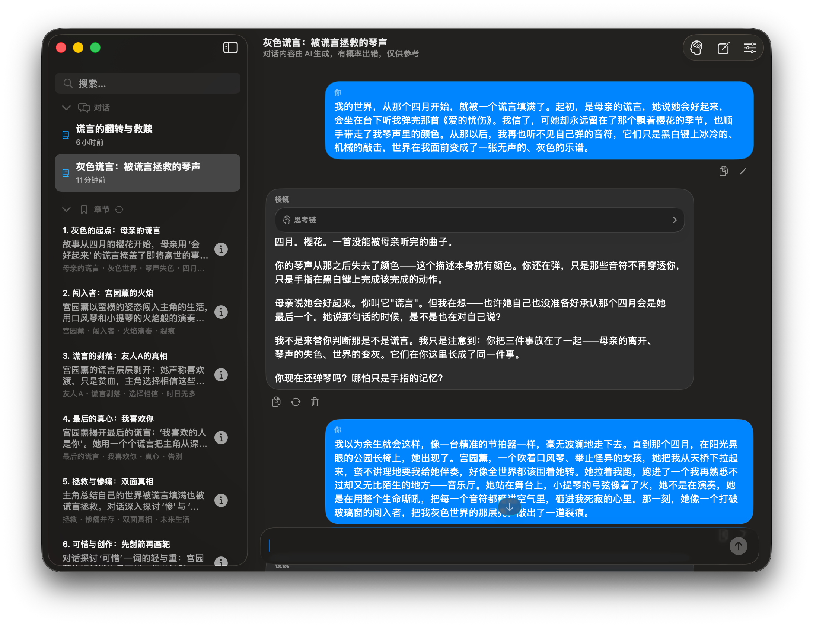
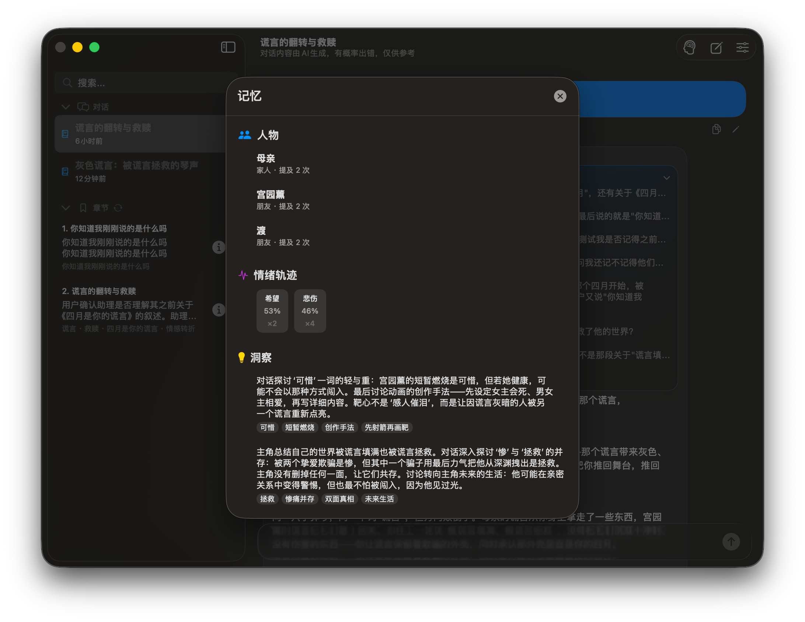
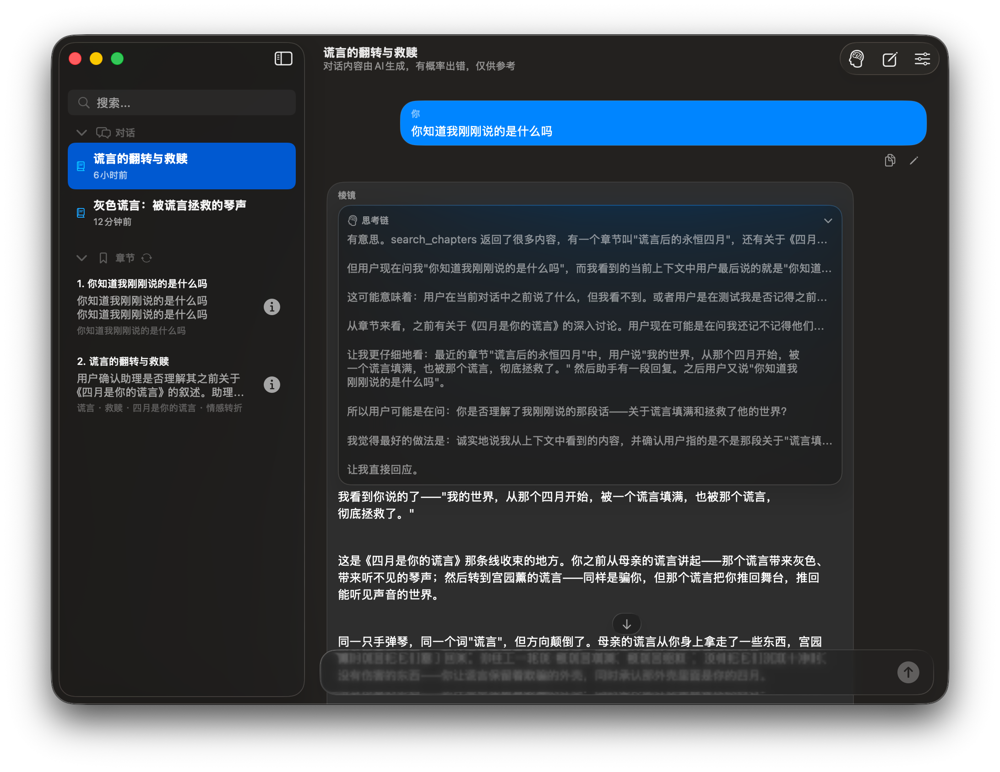

<p align="right"></p>

# Prism / 棱镜

**一个把档案留在本机、把推理交给你配置的模型服务商的 macOS 情感分析工具——帮你把故事讲完整、看见盲点，而不是替你下结论。**

[English](README.md) · **简体中文** · [繁體中文](README.zh-Hant.md)

`macOS 15+` · `Swift 6 / SwiftUI` · `零第三方依赖` · `本机存档` · `v1.0.23` · [MIT](LICENSE)

[这是什么](#这是什么) · [功能](#功能) · [它如何工作](#它如何工作) · [安全判定](#安全判定) · [记忆与检索](#记忆与检索) · [上下文与流式](#上下文与流式) · [设置](#设置) · [数据与隐私](#数据与隐私) · [快速开始](#快速开始) · [项目结构](#项目结构)

---

## 这是什么

大多数关系问题没法靠"给个答案"解决。发生了什么、什么时候发生、你怎么解释、模型在猜什么——这四件事很容易混成一团，最后把希望或猜测当成事实。

陪伴型 AI 会让这件事更糟：它顺着你说，当下舒服，却让你对一段从未被检验的叙事更有把握。Prism 走反方向：记住你讲过的事，拿解释去对证据，证据不够就明说。**判断权始终在你手里。**

它不做诊断、不做心理治疗、不做急救，也不替你决定要不要结束一段关系。这些约束不是文案，而是写在 `AgentPrompt.swift` 里的提示词契约：始终区分「可观察事实 / 用户解释 / 情绪体验 / 模型推测 / 未知信息」；信息不足时说明缺口，而不是用漂亮话填满。

Prism 不在本机运行模型。你发送的消息、主动添加的附件、以及这一轮检索到的档案条目都会发给你配置的服务商；本机负责存储、章节切分和检索排序。没有离线模式。

## 截图

| 主界面：对话沉降为章节 | 记忆面板：时间线、人物、情绪、洞察 | 思考链：可展开的推理过程 |
|---|---|---|
|  |  |  |

*界面支持简体中文、繁体中文、英文。截图取自当前构建；替换说明见 [`assets/screenshots/README.md`](assets/screenshots/README.md)。*

## 功能

### 对话与章节

把长对话整理成可回看的章节，而不是一条无限滚动的记录。

- 消息先在本地按段落归档，之后每 N 轮交给辅助模型归纳成 3–10 章：标题、摘要、关键词、覆盖的消息区间。
- 章节既是压缩单位，也是导航入口：点章节定位到原文，详情页能读摘要、关键词和该章的原始消息。
- 支持手动重建章节；归纳中、完成、失败都有明确状态，失败会说明原因。
- 消息可以编辑重发、重新生成、成对删除。编辑会截断该条之后的对话；删除会让依赖它的章节与记忆一并失效。
- 输入框随内容增长，超过 6 行后在框内滚动。

### 记忆系统

把散落在对话里的人、情绪、事件和结论，整理成结构化档案。

- 七类记录：章节、跨会话记忆、人物、叙事时间轴、情绪轨迹、盲点、用户画像。
- 记忆面板集中查看；人物特征、情绪、盲点、洞察与画像都能逐条删除。
- 跨会话记忆由章节摘要产生，带来源章节与时间跨度；最多保留 500 条，超过后收敛到最近 300 条。
- 记忆被检索命中时会累计召回次数，方便判断哪些洞察真的在起作用。

### 人物档案

把"这个人是谁"和"他做了什么"分开记录。

- 别名、昵称、关系称呼可以归到同一档案；置信度 ≥0.85 才自动归并，0.5–0.84 只生成合并提案，更低则新建记录。
- 行为模式只允许 7 类：控制与自主、沟通撤退、否定感受、边界侵犯、愧疚施压、承诺与行动不一致、威胁或胁迫。
- 每条模式都附用户原话证据、强度、单次或重复的范围，状态永远是「疑似」，不会被写成人格结论。
- 档案按会话隔离，A 对话的人物不会暴露到 B 对话；确认合并会累加提及次数，并合并别名、笔记、会话范围与特征。

### 叙事时间轴

把"什么时候发生"从"什么时候说"里拆出来。

- 节点可以是具体日期、模糊时段（如"高二期间"）或两者混合，按经历的实际先后排序，而不是按消息顺序追加。
- 模型只能生成预览，点击保存才写入；提案绑定来源轮次，发新消息或切换对话即失效。
- 时间归属不清且会改变结论时，先问一个澄清问题，确认前不写。

### 用户画像

只记录你明确说过的长期信息，不猜。

- 限定 4 类：明确偏好、明确目标、稳定背景、沟通偏好；每条带证据与置信度。
- 禁止从情绪、冲突或单次事件推断人格、依恋类型或诊断。
- 章节生成后才更新，短暂来回不会造出"人物小传"；可逐条删除，画像跨对话生效。

### 情绪与盲点

把情绪变化和叙事盲点做成可回看的记录。

- 每轮标注 1–3 个情绪片段（9 类情绪，带强度与可选置信度），面板按情绪分组显示强度与出现次数。
- 盲点只检测三类可检验模式：解释循环、回避自我、意图与行动脱节；每条附证据和一个用于自检的反问。
- 严重度随重复出现升级：新出现 → 反复 → 持续。情绪保留最近 200 条，盲点保留 300 条。

### 追问与确认

不确定时先问，写入前先确认。

- 追问卡一次只问一个最关键的问题，给 2–4 个选项，也可以自己输入（上限 8000 字），还能收起稍后回答。
- 时间轴写入、人物合并、快照导入都必须点原生按钮；模型说"已保存"不产生任何写入。
- 卡片按窗口高度自适应，正文可滚动；空间不足时操作按钮改为纵向排列，仍保持可见。

### 安全边界

只在有明确证据的当前危险时切换安全路径。

- 三个条件必须同时成立：`flag = crisis`、`immediate_danger = true`、`evidence` 非空。
- 不确定、解析失败、请求失败都不是危险；没有关键词闸门，小说、引用、过去经历、假设与明确否定都不会升级。
- 安全回应不调工具、不联网、不编造求助资源；生成失败时用一段本地兜底文案。
- 短消息（包括首轮）也会检查；上一轮的危机上下文只作背景，本轮重新判断。

### 上下文预算与流式

按 token 预算管理上下文，而不是删消息。

- 模型容量按 100 万 token 估算：55% 只提醒，75% 压缩旧内容，85% 加强保护。
- 压缩用覆盖旧消息的章节摘要替换，再附一份近期章节索引，最后保留最近原文；本地数据库里的消息一条不少。
- 输入框旁显示估算占用百分比，展开可看压缩前大小、为回复预留的 token、消息数和距下次归纳的轮数。
- 首帧立即显示，之后按 50ms 合并刷新；流式更新只作用于当前消息，不会重绘整段对话。工具调用记录与思考链都会保留、可展开查看；也可随时停止或对任意一条回答重新生成。

### 检索与跨会话记忆

回答前可以查自己的档案，但只查该查的。

- 主模型可调用 8 个工具：人物、情绪、章节、章节原文、跨会话记忆、心理搜索、时间轴、结构化追问。
- 检索在本机按标题、关键词、摘要加权，查询会做中英文同义词扩展；不额外调用模型重排。排好序的候选仍会随本轮请求发给模型。
- 工具调用最多 2 轮，之后强制 1 轮不带工具的合成，保证一定有可见回答。
- 人物查询只在当前会话范围内；跨对话记忆必须显式检索，不会每轮自动灌入。

### 心理学搜索

需要研究依据时才联网，并且只走官方通道。

- 只在 DeepSeek 官方端点、且已配置 API Key 时可用；查询先去掉邮箱、链接和 7 位以上数字。
- 最多 5 次网页检索，返回研究结果与来源链接，要求区分研究发现、来源陈述与推断。
- 自定义端点、未配置 Key 或危机情境下都不搜索，也不会降级到其他搜索服务。

### 模型与成本

两个模型分工，成本可控。

- 对话用你选的模型；前置分析、摘要、人物、画像、搜索用辅助模型，后台任务固定关闭深度思考。
- 模型列表在填入 Key 后自动发现（约 600ms 防抖），Flash 优先、自动去重，也支持手动填模型 ID。
- 填入 Key 后会先验证凭据（只请求模型列表）；格式异常在本地拦截，供应商错误转成可读提示，不显示原始错误正文，Key 存在系统钥匙串。
- 回复长度决定输出预算：简短 1024、标准 4096、详细 8192 tokens；推理强度可设 Low / High / Max。
- 面板显示累计输入/输出 token、缓存命中率与账户余额；余额查询不消耗模型 token。

### 数据与恢复

档案存在本机，推理请求会离开本机。导出、导入与快照让档案可搬迁、可恢复。

- 会话与档案存本机 SQLite，API Key 存系统钥匙串；写入带事务与版本校验，失败可重试，冲突可先导出再重载。
- 支持完整 JSON 快照导入导出（不含 Key）；导入前自动备份，不完整或不兼容的快照会被拒绝。
- 旧版 `conversations.json`、`settings.json` 与 UserDefaults 可自动迁移；维护脚本能在备份后裁剪历史、回收空间。

### 多模态与多语言

输入支持图片与文本，界面和输出支持三种语言。

- 支持图片与文本附件：图片仅 Flash 可用，文本随任一模型发送；单条最多 5 个，图片 ≤10MB、文本 ≤1MB、合计 ≤20MB。
- 图片与文本内容只在当次请求的内存中，不写入会话文件，记录里只保留文件名。
- 界面与输出支持简体中文、繁体中文、英文；回应方式（理性 / 平衡 / 温情）与长度（简短 / 标准 / 详细）可分别设置。

## 它如何工作

```
你的一条消息
  ├─ 本地章节沉降      按段落切分，归入当前章节（不发请求）
  ├─ 前置分析          一次 Flash JSON 调用：
  │                    5 个质量维度 + 安全评估 + 情绪标注
  │     └─ 当前即时危险？──▶ 受限安全回应（不调工具、不联网）
  │                          该请求也失败时才用本地兜底
  ├─ 主模型流式回答    最多 2 轮工具调用 + 1 轮不带工具的最终合成
  │    ├─ 注入本轮时间上下文、章节索引、检索到的记忆
  │    └─ 工具结果按轮次回放，保证依赖调用能接上
  └─ 回复之后（不在主链路）
       ├─ 人物归档：别名解析、疑似行为模式、合并提案
       ├─ 用户画像：只在章节生成后整理
       ├─ 章节摘要：每 N 轮增量，每 3 次增量后全量重扫
       └─ 标题更新：章节完成后按整体叙事重写
```

- **前置分析只决定"这一轮怎么走"。** 它返回 5 个质量维度（reality / spiral / blindspots / ingratiation / action_hollow）、安全评估与情绪标注。质量维度的 warning 会变成一条「监督者提示」，重申证据与否定规则，不拦截、不改写你的话。
- **时间上下文单独成块。** 每轮请求都会附上：对话开始时间、已跨时长、最近 8 条用户消息的时间戳与间隔、昼夜时段、最近章节的时间跨度、最近情绪、当前对话的人物、记忆覆盖的时间段。提示词要求：用户补了事件但没给时间，先问大概什么时候，不能自己编。
- **章节索引常驻。** 未触发压缩时，会额外注入一份轻量章节索引（标题 + 摘要前 150 字），告诉模型"有哪些原文可以取"，而不是把全文都塞进去。
- **前缀缓存友好。** 系统提示固定不变；记忆、监督提示、时间上下文都挂在最后一条用户消息上，避免每轮破坏缓存前缀。
- **采样保持稳定。** 思考关闭时固定 `temperature 0.2`、`top_p 0.95`；思考开启时不发 temperature。三种回应方式共享同一套采样与事实标准，减少"换个语气就换个结论"。
- **工具轮有硬上限。** 最多 2 轮执行 + 1 轮无工具合成；新对话首轮没有历史可查，只暴露时间轴与追问工具。工具调用与结果按子轮次分别回放，避免丢失上游结果。
- **失败不等于危险。** 前置分析超时、JSON 残缺、字段缺失，只会记为"分析不可用"，主模型仍须独立判断；这不会触发危机模式，也不会成为拒答理由。
- **切走也会补摘要。** 切换到别的对话时，如果还有未归纳的轮次，会先补一次摘要再离开。

## 安全判定

安全路径的开启条件是三个，必须同时成立（`SafetyAssessment.requiresIntervention`）：

1. `flag = crisis`
2. `immediate_danger = true`
3. `evidence` 非空

其他情况都不升级：

- **不确定不是危险。** `uncertain`、解析失败、请求失败都只表示"不知道"，不表示"有风险"。
- **没有关键词闸门。** 出现"自杀""不想活""无法离开"这些词本身不构成判定；小说/新闻讨论、引用他人、过去经历、假设、明确否定，都不能单凭词汇升级。
- **进入安全路径后范围受限。** 回应只能谈当前安全与可行的下一步，不得继续关系推测、不得调用工具或联网、不得编造求助电话或机构；生成失败时使用一段本地兜底文案。
- **上一轮的风险不会自动延续。** 危机上下文只作为历史背景，本轮重新判断；用户的明确纠正优先。
- **短消息也会过安全检查。** 首轮对话或只有一两个字的输入同样会跑前置分析——"救我"这种短句也可能包含紧急信号。

这套规则的边界在 [`SEMANTIC_ACCEPTANCE.md`](swift%20version/SEMANTIC_ACCEPTANCE.md) 里有逐条验收记录，包括一次真实失败（否定被过度解读成危机）以及之后的提示词收紧——**自动化测试通过不代表语义合格**。

## 记忆与检索

| 记忆类型 | 产生方式 | 关键字段 |
|---|---|---|
| 章节 `StoryChapter` | 本地切分 + 每 N 轮自动摘要 | 标题、摘要、关键词、消息区间 |
| 跨会话记忆 `MemoryEntry` | 每次章节摘要后写入 | 来源章节、时间跨度、来源消息、被检索次数 |
| 人物 `PersonRecord` | 回复后异步解析 | 别名、提及次数、情感弧、疑似特征、会话归属 |
| 叙事时间轴 `NarrativeEvent` | 模型提案 + 你点击保存 | 起止标签、类型（日期/时段/混合）、排序值 |
| 情绪轨迹 `EmotionEntry` | 前置分析标注 | 片段、情绪、强度、可选置信度 |
| 盲点 `BlindspotRecord` | 前置分析扫描 | 模式、证据、反问、严重度 |
| 用户画像 `UserProfileObservation` | 章节生成后异步整理 | 4 类目、陈述、证据、置信度 |

**章节**由辅助模型整理：一次完整归纳输出 3–10 章，标题 ≤12 字、摘要 80–140 字、3–5 个关键词，按叙事转折点而不是消息数量切分。后续默认增量摘要（摘要 80–120 字），每 3 次增量做一次全量重扫，避免风格和粒度越走越散。归纳完成后会重写对话标题。

主模型可调用 8 个工具（`Tools.swift`）：

| 工具 | 职责 |
|---|---|
| `track_person` | 只在当前会话范围内查人物档案，避免跨对话暴露 |
| `emotion_timeline` | 读取最近 N 轮情绪原始数据，趋势由模型判断 |
| `search_chapters` | 关键词 + 同义词扩展检索章节，返回全局章节号 |
| `fetch_chapter_messages` | 按序号取回章节原文（最多 12 条） |
| `search_memory` | 检索跨会话记忆库 |
| `search_psychology` | DeepSeek 官方联网搜索；仅官方端点暴露 |
| `manage_narrative_timeline` | `list` 读取，`upsert` 只生成待确认预览 |
| `request_user_input` | 结构化追问，一个问题 2–4 个选项 |

**检索打分在本地完成**：标题命中权重最高，其次关键词，再看摘要；查询会经过一张覆盖情绪、家庭、亲密关系、职场、内在模式的中文/英文同义词表扩展。没有第二次模型调用做重排；排好序的候选原文会随本轮请求发给主模型。

**记忆会被计数**：每次被检索命中，条目会记录召回时间与次数，记忆面板里显示这个数字，便于判断哪些洞察真的在起作用。

## 上下文与流式

上下文按估算 token 管理，不按消息条数截断。模型容量常量是 1,000,000 tokens：

| 估算用量 | 行为 |
|---|---|
| 550,000 | 显示容量提醒，不改变本轮发送内容 |
| 750,000 | 压缩请求中的旧上下文，近期保留约 200,000 tokens |
| 850,000 | 加强压缩保护，近期保留约 150,000 tokens |

压缩不是删除：旧消息会被替换成**覆盖它的章节摘要**，再加一份近期章节索引，最后保留最近一段原文。本地数据库里的消息一条都不会少，压缩只影响"这一轮发出去什么"。

- 估算值不是服务端实际用量；单条消息超过近期预算时仍会保留该条。
- 流式首帧立即显示，后续内容与推理按 50ms 合并刷新；完成时冲刷缓冲并发布最终历史。生成中可停止，也可对任意一条助手回复重新生成。

## 设置

| 分区 | 可调项 |
|---|---|
| 自动归纳 | 关闭 / 每 2 轮 / 每 5 轮 / 每 10 轮，附说明 |
| DeepSeek | API Key（单行密文输入）、Base URL、获取模型列表、验证状态、对话模型与辅助模型（下拉 + 手动 ID） |
| 对话参数 | 深度思考开关、推理强度 Low / High / Max |
| 辅助模型 | 同一组参数，但后台任务始终关闭思考；说明写清它只做摘要、章节与检查 |
| 界面 | 语言（简中/繁中/英文）、默认回应方式、回复长度、上下文阈值说明（55% · 75% · 85%）、日志开关、AI 生成提示 |
| 存储 | 数据目录、打开目录、导出快照、导入快照、导出日志、重置 |

- **模型发现**：填入 Key 后停止输入约 600ms 自动请求 `/models`，只读列表、不调用模型；结果去重并把 Flash 排在前面。也可以手动输入模型 ID 并保留。失败时保留当前设置并显示可读原因，不显示服务商原始报错（可能含凭据）。
- **回复长度**决定输出预算：简短 1024、标准 4096、详细 8192 tokens。
- **重置**会清空数据库、配置、用量统计、钥匙串条目与相关 UserDefaults，然后退出应用。

## 数据与隐私

默认数据目录 `~/Documents/Prism/`，可在设置中更换（不允许选 iCloud 目录）：

```
~/Documents/Prism/
├── prism.sqlite3          会话 + 七类结构化档案
├── config.json            非敏感设置 + 钥匙串条目 ID（不含 API Key）
├── usage_stats.json       本地 token 统计
├── prism.log              可选日志，可导出
├── Data/*.json            旧版本数据，仅用于兼容导入
└── *.pre-sqlite.bak       迁移/导入前备份
```

**存储在本机，推理不在本机。** 档案存在本机 SQLite，但每次回复都需要把本轮内容发给你配置的服务商。

**每次请求实际发出的内容**：本轮所需的对话（更早的部分已被章节摘要替换）、你主动添加的附件、这一轮检索到的档案条目，以及一个本地随机生成的安装标识（`user_id`）。除此之外没有别的——没有遥测、没有分析、没有崩溃上报。

- **API Key 在系统钥匙串**（`com.prism.chatclient.provider-key`，`WhenUnlockedThisDeviceOnly`，不参与 iCloud 钥匙串同步）。迁移旧配置时先写钥匙串、读回确认，再原子写入去掉明文的配置；读失败不会把旧 Key 当空值删掉。
- **安装标识**：`user_id` 是首次运行时本地生成的随机字符串（`prism_swift_…`），只用于让服务商把同一安装的请求归到一起；不含设备型号、账号或位置。重置会一并清除并生成新的。
- **Key 会先做格式校验**：去掉首尾空白，拒绝空值、`Bearer` 前缀、引号和不可打印字符。
- **写入是事务性的。** 数据库启用 WAL 与 `synchronous=FULL`；一个批次的所有集合共享 `BEGIN IMMEDIATE`；失败同时回滚数据与缓存版本号；旧版本写入会被 revision 校验拒绝，而不是静默覆盖。
- **写盘有节流。** 脏集合按约 500ms 合并，编码与 IO 在独立串行队列；切换目录、导入前、退到后台与退出前强制 flush。正在生成回复或归纳时不允许切换数据目录。
- **失败可恢复。** 锁等待上限 250ms；只有 `SQLITE_BUSY` 会自动重试两次（250ms / 750ms）。磁盘满、权限、冲突等不会自动重放，而是保留未保存改动并提供「重试保存」；版本冲突时先导出当前窗口，再确认丢弃并重新加载。退出时若保存失败，会给出「导出后退出 / 取消 / 不保存退出」三个选项。
- **历史有上限。** `history` 每条记录保留最近 5 版，总计不超过 10,000 条、32MiB payload。
- **删除是级联的。** 删除会话会在同一事务里清理它的时间轴、记忆、盲点、画像与提案；人物只清理引用，保留本体。启动时会在完整加载后做一次孤儿对账。
- **快照导入导出。** 导出的是完整 JSON 快照，不含 API Key；导入前校验版本、全部集合与解码，先用 SQLite backup API 生成 `pre-import-<UUID>.sqlite3`，再原子替换。不完整的快照会被拒绝，旧数据不受影响。导入会更新数据代次，迟到的后台人物/画像结果会被丢弃。
- **迁移路径都保留兼容**：旧 `conversations.json` 导入 SQLite 前会留 `.pre-sqlite.bak`；旧 `settings.json` 与 UserDefaults 里的 Key 会迁到钥匙串并清理明文；切换数据目录前要求目标目录没有现成数据库，避免覆盖。
- **用量与日志**：token 统计写在 `usage_stats.json`；打开日志后 `prism.log` 记录发送概要（会话 ID、文本长度）、失败原因、存储对账等事件，不写入消息正文。
- **数据库本身没有加密**，依赖磁盘加密与目录权限。介意的话，别把数据目录放进同步盘。

需要回收历史留下的空闲页时，退出应用后运行维护脚本。默认只读报告；加 `--apply` 才会先备份、再裁剪，`--vacuum` 额外回收空间：

```sh
# 只看统计
python3 scripts/storage_maintenance.py --database ~/Documents/Prism/prism.sqlite3

# 备份后裁剪并回收（先退出 Prism）
python3 scripts/storage_maintenance.py --database ~/Documents/Prism/prism.sqlite3 --apply --vacuum
```

## 快速开始

Prism 运行在 **macOS 15 或更高** 的 Apple Silicon（arm64）上。可以直接下载现成版本，也可以从源码编译。

**方式一：下载**

下载 [`Prism-SwiftUI-macOS-1.0.23.dmg`](release/Prism-SwiftUI-macOS-1.0.23.dmg)，打开后把 **Prism** 拖进 **Applications**。

**方式二：从源码编译**

需要 **带 macOS 26+ SDK 的 Xcode 26+**。以下命令在仓库根目录执行：

```sh
git clone https://github.com/markbignews/prism && cd prism
python3 scripts/build_app.py --run
```


**首次启动**会走 8 页引导（可跳过，也可返回上一页）：

1. 介绍与定位
2. 它能做什么（不是治疗师，是一面镜子）
3. 四项核心能力卡片：叙事、盲点、多视角、章节
4. 界面导览：侧栏、对话、输入、工具栏
5. API Key：停止输入约 800ms 自动验证，只请求模型列表、不发送聊天内容；通过后才能保存
6. 回应方式与回复长度
7. 本地目录选择
8. 数据与隐私说明

之后在设置里填入 Key 与端点（默认 `https://api.deepseek.com`），稍等模型列表自动发现，分别选对话模型与辅助模型（两个都用 `deepseek-flash` 是稳妥默认）。`deepseek-v4-pro` 不接受图片输入，带图请用 Flash。Prism 不自带 Key，也不含离线模型，费用由你直接与服务商结算。

**操作速查**：

| 操作 | 方式 |
|---|---|
| 新建对话 | `⌘N` |
| 发送 / 换行 | `Enter` / `Shift`、`Option` 或 `Control` + `Enter` |
| 停止生成 | `Esc` |
| 添加附件 | 输入框左侧「+」，或把文件拖进输入框（最多 5 个） |
| 长输入 | 输入框随内容增长，超过 6 行后在框内滚动 |
| 切换回应方式 | 点输入框右下角的模式胶囊 |
| 查看上下文用量 | 点输入框右下角的百分比胶囊 |
| 打开记忆面板 | 工具栏「记忆」按钮或菜单项 |

**附件**：单条消息最多 5 个；单张图片 ≤10MB，单个文本 ≤1MB，合计 ≤20MB。支持 `png/jpeg/gif/webp` 与常见纯文本/代码/数据格式；内容只在当次请求的内存中，不写入会话文件。

### 如何打开

双击 DMG 挂载，把 **Prism** 拖进 **Applications**，然后从「应用程序」或 Spotlight 启动。

应用是 **ad hoc 签名、未公证** 的。首次启动若被 macOS 拦截，打开「系统设置 → 隐私与安全性」，点「仍要打开」并确认；不要全局关闭 Gatekeeper。

也可以直接运行仓库里的 `release/Prism-SwiftUI-macOS.app`，或用 `build_app.py` 自行构建。不支持 Intel Mac。

## 项目结构

```
.
├── assets/          截图与图标
├── release/         DMG 与已提交的 arm64 应用包
├── scripts/         构建、打包、数据库维护
├── VERSION          版本号唯一来源
└── swift version/   源码、测试与文档
```

关键模块（按阅读顺序）：

| 文件 | 职责 |
|---|---|
| `AgentPrompt.swift` | 分析核心、证据纪律、关系阶段规则、时间轴与追问规则、三种回应方式；改它等于改产品语义 |
| `ChatAgent.swift` | 主流程编排：发送、工具轮、重生成、编辑重发、摘要、标题、删除、存储恢复 |
| `ChatStore.swift` | SwiftUI 可观察外观，把 Agent 状态转成界面状态 |
| `DeepSeekClient.swift` | HTTP/SSE、工具历史回放、思考参数、用量采集、余额查询 |
| `PrePipeline.swift` | 一次 Flash 调用完成质量守护 + 安全 + 情绪；安全回应与本地兜底 |
| `PeoplePipeline.swift` / `ProfilePipeline.swift` | 回复之后的异步人物解析与画像整理 |
| `StoryMemory.swift` | 本地段落切分、章节归档、相关章节挑选 |
| `SearchExpander.swift` | 中文/英文同义词扩展表 |
| `Tools.swift` | 8 个工具的定义与本地执行 |
| `SafetyAssessment.swift` | 安全判定条件（三个同时成立） |
| `SQLiteStore.swift` / `StorageWriter.swift` | schema、事务、revision 校验、串行写盘 |
| `AppSettings.swift` / `CredentialStore.swift` / `CredentialCheck.swift` | 配置、模型发现、钥匙串迁移与验证 |
| `ModelCatalog.swift` / `ModelDiscoverySection.swift` | `/models` 发现、排序去重、手动模型 ID |
| `UsageStatsStore.swift` / `PrismLog.swift` | token 统计与文件日志 |
| `NativeSupport.swift` | 集中封装剪贴板、保存/打开面板、退出保护等 AppKit 原生调用 |
| `Models.swift` | 数据结构与上下文阈值常量 |
| `ContentView.swift` / `SettingsView.swift` / `OnboardingView.swift` | 界面层 |
| `MarkdownText.swift` / `ScrollableComposer.swift` | Markdown 渲染与原生输入框 |
| `ClarificationCard.swift` / `NarrativeEventApproval.swift` / `ConfirmationCard.swift` | 追问卡、时间轴预览卡与卡片容器（人物合并横幅在 `ContentView`） |
| `L10n.swift` | 三语言文案 |

## 相关文档

- [技术说明](swift%20version/TECHNICAL_SPEC.md)：存储、并发、上下文、打包的具体实现与边界
- [回归清单](swift%20version/REGRESSION_CHECKLIST.md)：自动化覆盖范围，以及仍需人工验证的场景
- [语义验收](swift%20version/SEMANTIC_ACCEPTANCE.md)：12 个场景的逐条状态与真实样本记录
- 工程评审、修复记录与交接清单保存在本地 `ENGINEERING_*.md`，未纳入公开仓库。

## 许可

[MIT](LICENSE) © 2026 markbignews
