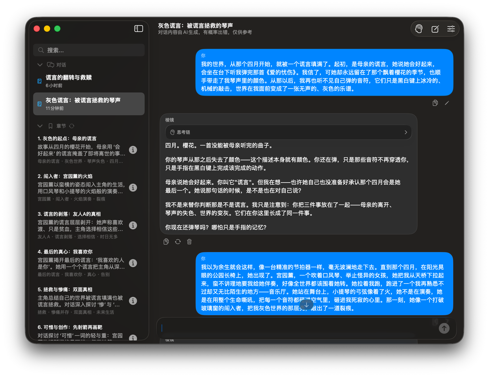
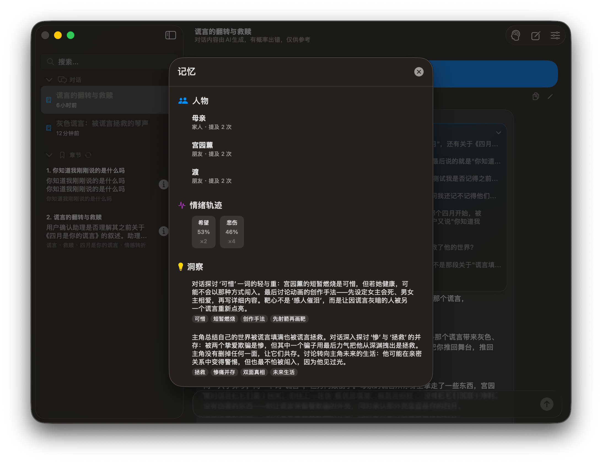

# Prism / 棱镜

**一个本地优先的 macOS 应用，用来把一段关系想清楚——不是顺着你说话的伴侣型 AI。**

[English](README.md)

`macOS 15+` · `Swift 6 / SwiftUI` · `零第三方依赖` · `本地 SQLite` · `v1.0.23` · `MIT`

---

很多关系问题不是「给一个答案」就能解决的。发生了什么、什么时候发生、你怎么理解、模型又推测了什么，混在一起时，很容易把希望或猜测当成事实。

伴侣型 AI 往往让这件事更糟：它顺着你说，当下舒服，却让你对一个从没核对过的说法更确信。Prism 站在反面。它记住你讲过什么，把不同解释放到证据前面比一比，证据不够就直说。**最后怎么判断，还是由你自己决定。**

## 截图

<!-- 预留区域，共三个槽位，顺序固定。新截图放入 Prism/assets/screenshots/，命名、尺寸与内容规范见该目录下的 README.md。
     下面是可直接使用的替换块，文件就位后删掉注释标记即可：

| 主界面：对话变成章节 | 记忆：时间轴 / 人物 / 情绪 / 洞察 | 询问与确认窗口 |
|---|---|---|
|  |  |  |
-->

| 主界面：对话变成章节 | 记忆：时间轴 / 人物 / 情绪 / 洞察 | 询问与确认窗口 |
|---|---|---|
|  |  | *截图待补充——Prism 需要追问或需要你批准时出现的原生卡片。* |

*界面提供简体中文、繁體中文与 English 三种语言。上面两张来自当前构建，属于待替换的版本。*

## 它能做什么

- **用章节代替滚动记录。** 长对话按叙事阶段归纳成章节；原始消息留在本地，需要时模型可以调回原文。
- **人物与别名分开记录。** 名字对不上时，Prism 会先让你确认，而不是把两个人合成一个。行为记录始终标记为*疑似*并附带证据，不是给人格下结论。
- **事情发生的时间不等于消息发送的时间。** 「今天说起」不会变成「今天发生」；你叙述的事件有自己的时间轴，按实际先后排序。
- **每条分析都能追回原文。** 结论可以关联到原消息，工具调用与思考链默认展开，方便你检查它到底依据了什么。
- **缺失的信息它会问，而不是编。** 当一个缺失的事实会改变结论时，模型停下来问一个问题并给出 2–4 个选项，你也可以自己写答案。
- **不会背着你写任何东西。** 保存时间轴事件、合并人物、导入快照，都必须经过一张原生卡片由你确认；模型说「已保存」不产生任何效果。
- **三种语气，一套证据标准。** 理性 / 平衡 / 温情只改变措辞与呈现顺序，不能改变证据门槛、风险判断，也不能改变「是否建议结束关系」。

## 它怎么工作

```
你的消息
  ├─ 章节写入          本地完成：拆分并归入当前章节
  ├─ 前置守护          一次快模型 JSON 调用：5 个回复质量维度 + 安全 + 情绪
  │      └─ 确认即时危险？──▶ 受限的安全回应（禁工具、禁联网）；
  │                            只有该请求失败才用本地兜底文案
  └─ 主模型流式回答    最多 2 轮工具调用 + 1 轮无工具的最终合成轮，
                       保证「撞上限也一定给用户一个可见回答」
       └─ 之后，全部离开回复路径：守护观测归档、人物消解、用户画像、章节归纳
```

- **两个模型，按职责分工。** 后台分析、归纳、人物消解与画像使用快模型；对话使用你选择的模型（默认 `deepseek-flash`）。
- **安全路由刻意做得很窄。** 只有同时满足「判定为危机」**且**「存在当前危险」**且**「证据非空」三条，才进入安全回应路径。不确定、解析失败、字段缺失都不算危险证据，也没有关键词拦截——讨论小说、否定过去的念头、讨论某个概念，都不会被当成危机。
- **上下文按预算管理，不按消息条数。** 以 100 万 token 为基准：55% 只显示容量提醒，75% 开始把旧消息压缩成章节摘要，85% 进入加强保护。**本地原始消息永不删除**，压缩只改变发送内容。
- **检索在本地完成。** 章节、人物、情绪、时间轴、跨对话记忆都存在 SQLite 里，用关键词与同义词在本地排序。联网搜索只用于真正需要心理学研究依据的问题，只在 DeepSeek 官方端点启用，并要求查询先脱敏。

## 隐私与数据

所有数据保存在本地，默认目录 `~/Documents/Prism/`：

```
~/Documents/Prism/
├── prism.sqlite3      会话、人物、情绪、时间轴、记忆
├── config.json        仅设置——API Key 不在这里
├── usage_stats.json   本地 token 统计
└── prism.log          可选日志，可导出
```

- **API Key 存在 macOS 钥匙串**，不在配置文件里。
- **每次请求发送**：完成当前轮次所需的对话（超出窗口的旧消息已被章节摘要替换）、你主动添加的附件、以及本轮检索到的档案条目。没有别的。**没有遥测、没有埋点、没有崩溃上报。**
- **iCloud 存储是刻意移除的。** 如果数据目录位于 iCloud Drive，Prism 会提示你改到本地目录，并提供一次性本地导入。
- 写入走事务并校验版本号：过期的写入会被拒绝，而不是静默覆盖；删除会话会在同一个事务里清理它的关联记录。设置页支持完整快照导出与导入，导入前总会先备份现有数据库。
- 数据库本身未加密，依赖系统磁盘加密与目录权限。如果这对你重要，请把这个目录排除在同步盘之外。

## 快速开始

需要 **macOS 15 或更高**、**Xcode 26 或更新版本**（提供 macOS SDK）；打包产物面向 Apple Silicon。

```sh
git clone https://github.com/markbignews/prism && cd prism

# 构建并运行
python3 Prism/scripts/build_app.py --run

# 自动化测试（60 项；使用临时目录与 mock HTTP，不需要真实 API Key）
cd "Prism/swift version" && swift test -Xswiftc -warnings-as-errors

# 构建并校验应用包，同时同步到 Prism/release/
python3 Prism/scripts/package_app.py --sync-release
```

仓库内已提交可直接打开的产物：[`Prism/release/Prism-SwiftUI-macOS.app`](Prism/release)。它是 **ad hoc 签名、未公证**，macOS 会要求你手动批准（见 [Apple 说明](https://support.apple.com/zh-cn/102445)）。`package_app.py --help` 提供 Developer ID 签名与公证选项，`--digest` 可复核包内的源码摘要，`--backup-dir` 控制被替换的旧包保存在哪里。

**首次设置：** 打开应用，填入 API Key 与端点（默认 `https://api.deepseek.com`），刷新模型列表，然后选择对话模型与后台模型——两个都用 `deepseek-flash` 是稳妥的默认值。`deepseek-v4-pro` 不支持图片输入。Prism 不附带 API Key，也不包含离线模型：用量由你直接向服务商付费。

## 现状与局限

把话说清楚：

- **v1.0.23**，60 项自动化测试，覆盖安全路由、模型配置、流式输出、确认流程、存储恢复、事务回滚、迁移与快照往返。GitHub Actions 已配置在 `macos-26` 与 `xcode-27` runner 上与打包脚本一起运行，但**尚未在远端实际执行过**，也未启用必需状态检查——目前「测试通过」的依据是本地运行结果。
- **自动化测试通过不代表模型判断正确。** 语义与 UI 验收**尚未完成**：[`SEMANTIC_ACCEPTANCE.md`](Prism/swift%20version/SEMANTIC_ACCEPTANCE.md) 列出 12 个场景，其中 4 个已采集真实模型样本（含一次真实失败——否定语义被过度解释成危机），其余仍待人工核验。
- **不是医疗服务。** 不做诊断、不做治疗、不是急救。如果你或他人正面临即时危险，请联系当地急救服务——不要依赖本应用。
- **仅 macOS 15+ 与 arm64。** 没有 Windows / Linux 版本；此前的 Tauri/Rust 客户端已移除。
- **没有多设备同步。** 跨机器使用需要导出/导入快照，并在每台机器上各自配置 API Key。
- **每轮对话会产生多次模型请求**（后台守护 + 回复，外加可选的工具轮与后台归纳），延迟与费用随思考模式和长上下文的开启程度上升。
- **单一维护者，无支持承诺。** 没有遥测，排查问题通常需要你导出 `prism.log`。

## 仓库结构

```
Prism/
├── assets/                    截图与图标
├── release/                   已提交的 arm64 应用包（ad hoc 签名）
├── scripts/                   构建、打包与数据库维护脚本
├── VERSION                    版本号唯一来源
└── swift version/
    ├── Sources/Prism/         应用本体（37 个 Swift 文件，无第三方依赖）
    ├── Tests/PrismTests/      60 项测试
    ├── TECHNICAL_SPEC.md      架构与实现细节
    ├── REGRESSION_CHECKLIST.md 自动化测试覆盖了什么、没覆盖什么
    └── SEMANTIC_ACCEPTANCE.md 语义与 UI 验收清单
```

建议从 [`AgentPrompt.swift`](Prism/swift%20version/Sources/Prism/AgentPrompt.swift)（分析与证据规则）、[`ChatAgent.swift`](Prism/swift%20version/Sources/Prism/ChatAgent.swift)（处理链条）、[`SQLiteStore.swift`](Prism/swift%20version/Sources/Prism/SQLiteStore.swift)（存储）开始读。

## 许可

[MIT](Prism/LICENSE)

[markbignews](https://github.com/markbignews)
